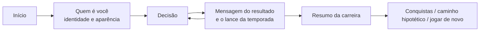

# Futeiros v2: Craque e Técnico

## Estado atual e leitura inicial (D88, 22/10/2026)

O projeto ativo é exclusivamente esta pasta `v2/`: React, Zustand e Vite.
Craque usa **`ENGINE_VERSION 2.0.0-m23`**; Técnico usa **`COACH_VERSION 1.9.0`**.
Para começar do zero, leia `AI_RULES.md`, este resumo, a arquitetura e os comandos
abaixo, o [GDD](docs/GDD.md) e o [README do Técnico](README-TECNICO.md).
As revisões D73 a D88 ao fim dos documentos detalham o estado atual e prevalecem
sobre descrições históricas do mesmo assunto. [DECISOES.md](docs/DECISOES.md)
registra o motivo das escolhas; os relatórios em `tools/balance/relatorios/`
registram resultados observados, sem garantir ocorrências raras.

- O Craque tem **39 acontecimentos e 53 cenas de partida**. Partidas, promessas
  e reinvenção são etapas do mesmo ano, organizadas em `career/drama.ts` e
  `career/matchMoments.ts`. Finais continentais vêm após outros jogos de clubes
  e antes dos jogos de seleção. Rival pessoal foi removido; rivalidade entre
  clubes continua. “Um treino aberto no bairro” saiu do catálogo. Pé preferido
  não aparece na criação; o campo legado continua compatível com os replays.
- No rápido, o período cobre duas temporadas, com no máximo uma partida por
  ano. Cada ano é revelado quando sua decisão termina; promessas somam os dois
  anos. Treino tem efeito imediato. Reinvenção é opcional: idade mínima 33,
  perda de pelo menos dois de OVR nos últimos dois anos e convite semeado de
  45%. Benefícios e custos aparecem em chips; o caminho permanece no motor.
- Chances usam os atributos específicos da ação (95%) e OVR (5%), vezes
  `limitar(1 + (OVR - média atual da divisão) × 0,004; 0,90; 1,10)` em clubes.
  Seleções não recebem o fator da liga. Tetos: protagonismo 70%, coletivo
  sorteado entre 70% e 80%, conservador entre 70% e 90%. Exceções explícitas:
  gol olímpico 8%, bicicleta 35%, goleiro na área 18%/40%, pênalti de linha
  70%, defesa de pênalti 35% (45% com especialista), companheiro cobra a 50%.
  Bônus de veterano e ajuste por idade continuam sujeitos aos tetos.
- Bicicleta precisa de autorização de 20% dentro da família elegível, inclusive
  ao repetir cenas. Há participações raras fora da posição e goleiro na área
  apenas no mata-mata. Em liga, 18% dos lances começam um gol atrás: acerto
  busca empate, erro mantém derrota ou sofre outro gol. Começando empatado,
  erro que não resolve a partida tem 12% de terminar empatado. Placar inicial
  varia; resultado individual e resultado da equipe são coisas distintas.
- O destaque ajuda mais um elenco fraco: adicional à ajuda base de
  `participação × limitar((76 - força) / 16; 0; 1) × limitar((OVR - força - 8) × 0,12; 0; 2)`.
  Não garante título. Reconhecimento dá até `0,55` de capacidade por ocorrência,
  no máximo três/ano, reduzindo até zero em potencial +2 (D78). Não compra OVR
  integral por título. Valor de mercado considera idade, OVR e média da divisão
  atual, com fator de liga entre 0,55 e 1,10 e teto etário de até €400M.
- Resultado aparece na mesma decisão; placar tem animação própria, escolha fica
  marcada e aviso chega no clique. Leitura dura 2.100ms e saída lateral 560ms.
  A apresentação conserva o espaço e o tema do card até a saída terminar,
  inclusive no celular; só então mostra a próxima revista. Movimento reduzido
  remove a animação. Não há animações procedurais de resultado em Canvas.
- Jornal tem duas folhas do mesmo ano, capa e bastidores; segunda folha vazia
  quando não há conteúdo. No celular, visão proporcional e leitura ampliada.
  As setas junto de fechar mudam a temporada sem fechar a leitura, conservando
  capa/bastidores e desabilitando nos extremos. Crônicas usam terceira pessoa
  em PT/EN/ES; feedback da partida permanece direto ao jogador. Texto usa
  Schibsted Grotesk, com 14px na crônica ampliada e promessa em negrito.
- Cada decisão de partida é uma **transmissão** (D83): a competição tem cores,
  padrão de fundo, selo, filete e LED próprios (estrelas na Champions, raios de
  ouro na Libertadores, globo no Mundial, mosaico na Euro, tecido andino na Copa
  América, o DNA do país nas ligas e a chave do mata-mata nas copas), e o time de
  quem joga entra no brilho, no filete do lance, nas barras do placar e no
  cachecol ou bandeira do cabeçalho. Só interface; o motor não muda.
- “Semana de clássico”: provocar mantém 55% para torcida +12, falha -10;
  **Respeitar o rival custa torcida -2, sem sorteio**. Laboratório e ferramentas
  para forçar decisões existem só em desenvolvimento e usam as peças reais.

O motor é puro, determinístico e separado do texto e da interface. Saves guardam
setup e escolhas, reconstruídos por replay, com versão obrigatória. Mudanças no
resultado exigem nova versão, `pnpm balance` e as 51 metas. Antes de entregar:
`pnpm verify` e `pnpm e2e`; mudanças em produção/títulos exigem também auditoria
de recordes. As amostras de navegador atuais são replays **m23**, reconstruídos
com escolhas válidas, não resultados fabricados.

> **Futeiros (D50 a D61).** O site virou um hub com dois jogos de futebol e
> abre sempre nele: **Craque**, a carreira de jogador descrita neste README
> (motor `2.0.0-m23`), e **Técnico**, a carreira de
> treinador nova (motor próprio `COACH_VERSION 1.9.0`, 24 temporadas, elencos
> reais, com retomada da última carreira em andamento, só competições de clubes por enquanto). O Técnico tem
> README próprio, com todas as contas: **[README-TECNICO.md](README-TECNICO.md)**,
> e a especificação na [seção 42 do GDD](docs/GDD.md#42-técnico-a-carreira-de-treinador).
> O hub está na [seção 41](docs/GDD.md#41-o-hub-do-futeiros). O modo de treinador ativo é o Técnico (`packages/engine/src/coach`).
> O protótipo experimental `manager`, sem consumidores e incompleto, foi retirado
> do código ativo na D62 com uma cópia externa preservada.

> **Revisão D63 (12/10/2026).** Craque `2.0.0-m10`; Técnico `1.4.0`.
> A última carreira do Técnico em andamento é retomável neste aparelho por replay de
> setup e comandos; encerrá-la remove o registro. O Craque não guarda sessões de
> carreira; preferências, rascunhos, conquistas e ranking continuam independentes.
> As regras abaixo de D61 substituem as notas históricas sobre salvamento, finanças,
> formações, eventos, vibração e bônus por conquistas.

> **Revisão de 8 de outubro de 2026 (D47, motor `2.0.0-m8.3`).**
> Esta revisão substitui as regras anteriores indicadas abaixo.
>
> - Tema inicial e manifesto PWA claros (#F3F0E8), respeitando a preferência já salva. Abas de aparência com
>   altura estável no PC e celular (controles com rolagem própria), painéis preservados e transição breve, sem movimento
>   quando reduzido. Retrato da carta centralizado. Jornal com cabeçalho esportivo,
>   filetes e estatísticas mais legíveis. Resultado da decisão dentro do layout,
>   sem cobrir texto, mantido até a próxima escolha; no celular mostra o resultado
>   curto, com o detalhe no lance.
> - Renovação usa nome e expectativa próprios em todas as dez missões, por exemplo
>   “Renovação de estrela” e “Fica para ensinar os mais novos”, sem mudar a cobrança.
> - Legado: zero jogos dá zero pontos. Pontos = `4 × participação +
>   (10 × importância dos títulos + 2 × prêmios + bônus de torcida) ×
>   min(1, participação / 0,85)`, vezes o traço. Participação usa os jogos realmente disputados sobre os jogos
>   do clube, limitada ao papel no elenco. Ídolo exige 60 jogos no clube e lenda
>   exige 120, além dos pontos e temporadas. O bônus de torcida é 3 com apoio
>   de pelo menos 80. Lendas de 33 anos ou mais não perdem apoio pelo banco ou
>   declínio natural; rebaixamento ainda pode tirar até 2 pontos por temporada.
> - Clássico, estádio lotado, final, pênalti e cartão vermelho exigem
>   pelo menos rotação e 12 jogos na temporada
>   anterior. Estádio lotado agora sobe/desce o papel no elenco e muda torcida
>   (+5/-3), efeitos úteis em qualquer posição. Disputar a vaga com a joia da base
>   tem 50% exatos de aumentar os jogos planejados em 20% e 50% de reduzir em
>   20%, sem ajuste pelo traço, respeitando jogos disponíveis e lesões.
> - Novo evento “Uma nova seleção” (peso 70 no sorteio de eventos elegíveis):
>   cinco temporadas consecutivas no mesmo país estrangeiro, mesmo mudando de
>   clube, nenhuma estreia pela seleção e OVR suficiente para ao menos convocação
>   ocasional no país de residência. Aceitar muda nacionalidade; recusar mantém.
>   A decisão depende da agenda, não é automática ao completar cinco anos.
> - Título de clube ou seleção conquistado na temporada dá **+1 de OVR** sobre a
>   evolução natural, após crescimento, declínio, devolução de capacidade temporária
>   e garantia do treino, uma vez por temporada,
>   até 99 e respeitando atributos limitados a 99. Substitui a antiga moral variável.
>   OVR continua sendo calculado pelos atributos, nunca por um número separado.
> - Todos os clubes continuam evoluindo com sucesso, ruído e retorno à força base.
>   A força fica também limitada a ±10 da base. As estrelas das ofertas acompanham
>   a força atual, incluindo o impacto projetado do jogador: ±1 estrela no máximo
>   em relação à nota inicial, entre 1 e 5. Mudança exige ±3 pontos de força;
>   subir de 4 para 5 ou cair de 5 para 4 exige 4,5. O impacto continua sendo
>   `0,22 × participação × limitar(OVR - força, -3, 15)`, até +3,135 para um craque
>   de linha. Ganhar campeonatos ajuda a força, mas não garante uma estrela.
> - Desafio: “Regra da tentativa” substitui “Édito”; texto explica a penalidade
>   de metade da pontuação. Catálogo com 37 missões. Missão de temporadas como ídolo substituída por virar
>   lenda de um clube (alvo 1); nova missão de ídolo ou lenda de dois clubes
>   (alvo 2). Ambos são alvos fixos do produto, os demais seguem calibrados.
> - 148 conquistas com abas por categoria: 18 recordes gerados do catálogo e um título
>   por competição, automaticamente. Aba secreta com quatro conquistas naturais,
>   escondendo nome e requisito até desbloquear. Nova conquista de terminar no
>   clube da estreia em campo. Contagens persistem sem precisar guardar carreiras.
> - Hall da Fama desativado: arquivos antigos são apagados na abertura do banco;
>   carreiras concluídas/interrompidas e saves incompatíveis não são arquivados.
>   Permanecem o save atual, conquistas, contagens agregadas e ranking diário.
>   O resumo e o caminho hipotético continuam disponíveis para o save atual.
>   O capítulo passa a se chamar “{sobrenome} hipotético”.
> - Biografia explicita “camisa” ao citar o número 1 ou outro número histórico.
> - Metas revisadas pelo bônus obrigatório de título: pico médio Normal entre
>   P−2 e P+3; diferença entre grupos até 3 OVR; Bolas de Ouro de Fenômeno
>   de ataque com média entre 1 e 2,25, mantendo 40–60% com ao menos uma.
>   As missões de legado conservam os alvos 1/2 e só entram em faixas em que
>   15–55% do lote de calibragem os alcança, sem tolerância nesta seleção.
> - Talento no Difícil usa **pesos** 45/34/15/4/1, soma 99: probabilidades reais
>   45,45% / 34,34% / 15,15% / 4,04% / 1,01%. Normal: 28/34/22/11/5%.
> - Validação: 547 testes unitários, 44 ponta a ponta, build e 51 metas de
>   balanceamento aprovados; todos os recordes alcançados. (As notas da época
>   citavam um módulo `manager` que não existe neste repositório; ver D50.)

**Residência consecutiva (D48):** sair do país interrompe a contagem; ao voltar,
é preciso completar cinco novas temporadas seguidas. Anos de períodos separados
não se somam. Trocar de clube dentro do mesmo país mantém a sequência.
O ciclo obrigatório de testar, corrigir e retestar está em `AI_RULES.md`.

**Revisão D49, motor `2.0.0-m8.4`:** no diploma, estudar reduz evolução em
10% e risco de lesão em 30%; só futebol aumenta ambos em 10% e 30%,
respectivamente, durante o período. Ficar no ultimato dá torcida +4 e rompe
com o empresário: somente a próxima decisão pode trazer ofertas de clubes
pelo menos 2 pontos de força mais fracos que o atual. Se a decisão for treino
ou outro evento sem transferência, a restrição acaba mesmo assim. Não obriga
a sair, não reduz a força dos clubes e não afeta janelas posteriores.
Escudos e selos continuam desenhados por padrão; competições e prêmios usam
suas imagens reais quando disponíveis e arte gerada como reserva. O laboratório
compara o padrão misto, todas reais ou todas geradas; `VITE_ASSETS=gerado`
continua permitindo um build inteiramente desenhado. Troféus e prêmios carregam
assim que entram na tela, sem depender do carregamento adiado. O Vite ignora
os relatórios de testes para evitar travamento do observador no Windows.
Validação D49: 550 testes unitários, 48 ponta a ponta e 51 metas no
balanceamento completo aprovados. A pendência da amostra reduzida foi
resolvida na D57 (lote completo de Fenômenos no `balance:check`), e o `verify`
roda inteiro.

**Craque** é o simulador de carreira de jogador, jogado por decisões. Você monta um jogador de
16 anos, escolhe onde jogar, no que treinar e como reagir ao que acontece, e
vê a carreira inteira acontecer dentro de um mundo de futebol simulado:
tabelas, copas, continentais, seleções, prêmios e recordes reais. Uma carreira
completa leva poucos minutos.

O Futeiros abre no hub (`apps/game/src/screens/hub`), com um cartão para cada
jogo. O Craque começa uma carreira nova, sem saves de sessão. O Técnico oferece continuar a última carreira em andamento neste aparelho. Recarregar a página
sempre abre o hub (D50).

Este documento é a referência do projeto (e do Craque em detalhe; o Técnico
está no [README-TECNICO.md](README-TECNICO.md)): quem nunca viu o código deve
entender, só por ele, como o jogo funciona, como o motor calcula e onde cada
coisa mora. O detalhe completo de cada regra está no
[GDD](docs/GDD.md) (a especificação, com notas "Como ficou" onde a
implementação mudou algo), e o porquê de cada escolha está em
[docs/DECISOES.md](docs/DECISOES.md) (D1 em diante). **Antes de mudar qualquer
coisa, leia [AI_RULES.md](AI_RULES.md).**

> Este diretório (`v2/`) contém o único projeto ativo. A v1 foi removida na D62.
> A raiz oferece atalhos para estes comandos, sem dependências ou outro workspace.
> Dados, arte, testes e ferramentas da v2 são autossuficientes.

**Central do Técnico (D59):** painel executivo compacto, detalhes por hover/toque no
campo e no banco, decisões com risco e recompensa, resolução animada e barras de verba,
folha e excedente antes de contratar. Resultados com placar e seções retráteis.
Benefícios gratuitos de eventos/conversas agora têm custo ou chance de falhar;
as regras estão no [README do Técnico](README-TECNICO.md) e no GDD 42.16.
A projeção financeira permanece visível ao rolar os alvos;
alertas complexos abrem sob demanda. A revisão também corrige o contraste do contador de troféus do Craque no tema claro.


**Prancheta do Técnico (D60):** composição em duas colunas, HUD único de objetivo,
classificação e relações, arrasto de jogadores no mouse/toque, relatório visual.
Decisões com alternativa em foco e confirmação, sem rolagem e sem misturar chances
de vitória com metas táticas. Sem tela vazia de partida, próximos jogos parciais ou
evento de apostas. Reputação/finanças explicadas no i. Relações mudam a cada jogo;
diretoria mais paciente (demissão anual abaixo de 18 com objetivo não cumprido),
demissão no primeiro turno só em campanha desastrosa. Motor Técnico 1.2.0; detalhes
e limiares no README-TECNICO, GDD 42.17 e D60.
## Índice

1. [Visão geral](#1-visão-geral)
2. [O motor: as contas por trás da tela](#2-o-motor-as-contas-por-trás-da-tela)
3. [O mundo e os prêmios](#3-o-mundo-e-os-prêmios)
4. [Metagame: Desafio do dia, conquistas e caminho hipotético](#4-metagame)
5. [Arquitetura técnica](#5-arquitetura-técnica)
6. [Comandos](#6-comandos)
7. [Documentação e regras para quem mexe no código](#7-documentação-e-regras)

---

## 1. Visão geral

### 1.1 O laço do jogo



1. **Início.** Ritmo e dificuldade, Começar carreira, Jogo rápido (identidade
   e aparência sorteadas), o Desafio do dia, as conquistas e os números do mundo. O Início é para começar: a carreira em
   andamento não aparece nele; começar outra substitui o save atual, sem arquivo. Abrir o
   jogo de novo volta para a carreira guardada.
2. **Quem é você.** Sobrenome, número dos sonhos (opcional), país (211
   seleções) e posição (12), mais o editor de aparência. O jogador montado
   fica guardado para a próxima carreira.
3. **Decisões.** A tela da carreira mostra uma decisão por vez: a primeira
   base, a janela de transferências, empréstimos, volta de empréstimo,
   dispensa, eventos, foco de treino. Cada escolha joga uma temporada (ritmo
   Normal) ou duas (ritmo Rápida).
4. **O resultado.** Não há janela para fechar. Logo depois de confirmar,
   uma mensagem animada mostra o resultado da escolha (deu certo, deu errado,
   contrato assinado, você fica, treino escolhido), e a tela já traz a próxima
   decisão, com o lance da temporada (números contando, títulos, acesso ou
   queda, atributos que mudaram) e o jornal da temporada. Era a "Revelação"
   do GDD 22; virou isto (D43 e D45).
5. **Resumo.** Quando a carreira acaba (aposentadoria, idade, falta de
   mercado), o resumo traz biografia, linha do tempo, vitrine de troféus,
   jornal, recordes reais igualados ou batidos, o pôster para compartilhar e
   o "E se...?".

### 1.2 Regras de produto que valem para tudo

- **O laço cabe numa tela.** Decisão, lance e jornal nunca rolam a página, do
  celular de 360 × 640 ao PC (D23). Só as telas de exploração (histórico,
  biografia, vitrine, conquistas) rolam.
- **Ritmos.** Na tela, "Normal" é uma temporada por decisão (o padrão; no
  código, `intense`) e "Rápida" são duas (no código, `normal`). O GDD antigo
  usa "Intensa" para o Normal de hoje.
- **Dificuldades.** Normal e Difícil. O Difícil muda a chance de talento,
  cresce menos (×0,86), envelhece mais rápido (×1,25), machuca mais (×1,6),
  tira 3 do nível de mercado e dispensa mais cedo.
- **Idiomas.** Português (fonte), espanhol e inglês, em tudo, inclusive textos
  gerados (biografia, manchetes, capas).
- **Sem travessão em texto de jogo.** Os testes de idioma recusam "—" e "–".
- **Toda funcionalidade passa por duas perguntas:** cria algo interessante? O
  jogador entende o efeito facilmente? (ver [AI_RULES.md](AI_RULES.md)).

---

## 2. O motor: as contas por trás da tela

O motor (`packages/engine`) é **puro, semeado e imutável**: recebe estado e
escolha e devolve o estado novo, sem relógio, sem `Math.random`, sem React.
Todas as constantes citadas aqui estão no código, com o nome entre crases.

### 2.1 Sementes, replay e versão

- Todo sorteio vem de `stream(semente, sistema, ...partes)` (`rng.ts`):
  um gerador sfc32 por fluxo. Os sistemas são `birth`, `world`, `titles`,
  `season`, `growth`, `injury`, `awards`, `market`, `events`, `national`,
  `narrative`, `bio`, `scout`, `challenge` e `policy`. Cada torneio, cada
  temporada e cada característica do jogador tem o próprio fluxo, então mexer
  num sorteio nunca muda os outros.
- **O save é um replay** (D4): setup (semente, ano, ritmo, dificuldade,
  identidade) e a lista de escolhas. `replay()` refaz a carreira inteira e
  chega exatamente ao mesmo ponto. O save também guarda um retrato leve
  (`snapshot`) para mostrar a carreira sem rodar o motor.
- `ENGINE_VERSION` (`version.ts`, hoje `2.0.0-m18`) sobe sempre que a mesma
  entrada passa a produzir outra carreira. Save de outra versão abre só para
  leitura; o save incompatível pode ser descartado, sem arquivamento.

### 2.2 O jogador

Criado aos 16 anos (`player/player.ts`). O jogador nunca vê os números
internos: vê atributos e OVR.

| Característica | Como sai |
|---|---|
| Talento | Jornaleiro, Promessa, Craque, Estrela, Fenômeno: 28/34/22/11/5% no Normal, 45/34/15/4/1% no Difícil (`TALENT_ODDS`) |
| Potencial P | Teto suave do nível total, uniforme na faixa do talento: 66–74, 74–81, 81–87, 87–92, 92–97 (`POTENTIAL_RANGE`). Nunca aparece; o olheiro dá uma leitura aproximada |
| Capacidade L | Habilidade natural aos 16: `46 + 1,3 × faixa + N(0; 1,6)`, entre 43 e 56 |
| Prodígio | 14% das Estrelas e 26% dos Fenômenos já chegam prontos: L começa de 11 a 17 abaixo de P (`PRODIGY_CHANCE`, `PRODIGY_GAP`) |
| Idade de pico | Atacante 26,5; meia ofensivo 26,5; meio-campo 27,5; lateral 27; zagueiro 28,5; goleiro 30 (`PEAK_AGE_BASE`), ±2 pela maturação (precoce 15%, normal 70%, tardia 15%) |
| Longevidade | 7% dos jogadores de linha (fora zagueiros) ganham 3 anos a mais antes do declínio (`LONGEVITY`) |
| Traço | Competidor, Profissional, Líder, Artista, Cabeça quente, Frágil: mexem em crescimento, declínio, lesão, risco, torcida e legado (`TRAIT_EFFECTS`) |
| DNA | Desvio por atributo, N(0; 2,2), recentrado para não mudar o OVR, só o desenho da carta |
| Treino | Bônus permanentes por atributo, de 0 a +8 |

**Atributos e OVR.** Os seis atributos da carta (Ritmo, Finalização, Passe,
Drible, Defesa, Físico; no gol, Elasticidade, Manejo, Reposição, Reflexos,
Velocidade e Posicionamento) saem de

    atributo = limitar(arredondar(L + desenho da posição + DNA + curva da idade + treino), 1, 99)

e o OVR sai **sempre** dos atributos (invariante 1):

    OVR = limitar(arredondar(média ponderada pelos pesos da posição + bônus da posição), 1, 99)

Os pesos por posição estão em `player/positions.ts`. Exemplo: centroavante
10/42/8/20/0/20 com bônus 2; zagueiro 8/0/10/4/50/28 com bônus 3.

### 2.3 Evolução: crescimento, teto biológico e declínio

A cada temporada, L cresce (`evolution/growth.ts`, `evolution/tuning.ts`):

    ganho esperado = 7,6 × idade × folga × minutos × treinador × confiança × traço × dificuldade

- **Idade**: logística que cai à metade 2,5 anos antes do pico.
- **Folga** até o potencial, com saturação:
  `(máx(P − nível, 0) + 0,35) / (… + 9)`. Quem se adiantou desacelera perto
  do teto; quem se atrasou recupera. É a "tendência à média" do modelo.
- **Minutos**: `0,45 + 0,55 × mín(1, jogos / 34)`.
- **Treinador**: de 0,85 (clube de força 55) a 1,15 (força 90).
- **Confiança**: de 0,96 a 1,04, pela torcida.
- **Forma da temporada**: normal ×0,88–1,12; tropeço (8%) ×0,45–0,7; explosão
  ×1,25–1,45, com chance de 14% até 19 anos, 10% até 22, 5% até 25, 1,5%
  depois, e só com 20 jogos ou mais.
- **Teto biológico** (`capSeasonGain`): até 4,4 pontos numa temporada passam
  inteiros; acima disso o ganho rende cada vez menos e nunca chega a 7.
  Nenhuma temporada dá um salto irreal (o maior salto de OVR medido é +9).
- **Bônus de título (D47)**: +1 OVR após toda a evolução natural, uma vez
  por temporada com ao menos um título, inclusive no declínio. Limite 99.
- **Declínio** (`ageDecline`): começa 2 anos depois do pico, mais a folga da
  posição (zagueiro +1, goleiro +2) e a longevidade:
  `mín(4,5; 0,26 × anos + 0,05 × anos²)` por temporada, × traço × dificuldade.

### 2.4 Treino (foco)

Dos 17 aos 31 anos, no mínimo quatro anos depois do último foco, com 40% de
chance a cada decisão (`FOCUS_RULE`), aparece a decisão de foco: seis focos,
um por atributo (Arranque, Pontaria, Visão de jogo, Bola no pé, Marcação,
Força; no gol, Voo, Mãos firmes, Reposição, Reflexos, Explosão, Comando da
área). O foco soma **+2** ao atributo uma vez, no período seguinte, e garante
que ele termine o período pelo menos 2 acima de onde começou
(`TRAINING.focus`, `guaranteeFocus`).

### 2.5 Uma temporada do jogador

`season/playerSeason.ts`, nesta ordem:

1. **Papel no elenco** pela distância `d = OVR − força do clube`
   (`season/role.ts`): Craque do time (d ≥ 3, joga 95% dos jogos), Titular
   (d ≥ −1, 85%), Rotação (d ≥ −4, 60%), Reserva (d ≥ −8, 28%), Sem espaço
   (8%). Goleiro: Titular (d ≥ −2, 92%), Reserva (d ≥ −7, 12%), Terceiro (2%).
   Quem não é titular tem de 2% a 8% de chance de subir um degrau na
   temporada.
2. **O mundo inteiro** (seção 3), com o jogador somando força ao clube:
   `força + 0,22 × participação × limitar(OVR − força, −3, 15)`
   (`CLUB_IMPACT`), e à seleção (`NATIONAL_IMPACT`, 0,12).
3. **Jogos e lesão.** Jogos planejados = jogos do time × participação ×
   N(1; 0,06). Lesão (`season/injury.ts`): chance
   `0,14 × (1 + 0,05 por ano acima dos 28) × (1,15 − 0,3 × físico / 99) × traço × (1,6 no Difícil)`;
   tira de 5% a 22% dos jogos planejados.
4. **Produção**, competição por competição (`season/production.ts`). Os jogos
   dele são repartidos entre as competições na proporção dos jogos do time, e
   cada competição sorteia:
   - gols e assistências por **Poisson**, com taxa por jogo
     `(base da posição + oportunidades de finalização) × e^(0,032 × v(OVR − oposição)) × e^(0,03 × v(time − oposição)) × e^(0,035 × (Finalização − OVR)) × fase`,
     onde `v(d)` vale d até 10 e `10 + 0,12 × (d − 10)` acima (o joelho que
     impede 60 gols todo ano). Base de gols por jogo: centroavante 0,385;
     pontas 0,24; meia ofensivo 0,22; meias abertos 0,15; volante e laterais
     0,035; zagueiro 0,04 (`SCORING`). No m14, FIN acima de 80 abre
     oportunidades extras para pontas e meias conforme a função; ver D68.
     As assistências conservam a taxa-base e o coeficiente de nível 0,045,
     usando Passe no lugar de Finalização.
   - jogos sem sofrer gol por **binomial**, com chance
     `e^(−1,05 × sofridos por jogo)` e
     `sofridos = 1,2 × e^(−0,055 × (time + defesa − oposição))`.
   - a fase da temporada é log-normal (o Artista oscila mais).
5. **Seleção** (`season/national.ts`): pela distância `OVR − força da
   seleção`, Titular (≥ 2: 9 a 11 jogos fora de torneio), Elenco (≥ −1: 5 a 7),
   Ocasional (≥ −3: 1 a 3) ou fora; nos anos de torneio, joga o torneio.
   Produção com escala 0,6 (jogo de seleção é mais travado).
6. **Títulos**: título de clube só conta para quem jogou naquela competição;
   título de seleção, para quem estava no elenco do torneio.
7. **Prêmios** (seção 3.4) e **pressão do recorde** (2.6).
8. **Evolução** (2.3).

### 2.6 Pressão do recorde

Recorde é possível e raríssimo (D44, `records/pressure.ts`). Cada número que
encosta num recorde real tem uma cauda: até o começo dela nada muda; dali em
diante, cada unidade a mais (gol, jogo, convocação, título, Bola de Ouro) só
entra se passar num sorteio, e a chance cai a cada passo:

    chance do passo n = e^(−n / escala)

Exemplo: gols numa temporada têm cauda a partir de 62, escala 6. O 73º gol
entra com 16% de chance, o 74º com 14%, o 80º com 5%. Valem caudas para gols
na temporada, assistências, jogos sem sofrer gol do goleiro, gols e jogos na
carreira, gols e jogos pela seleção, títulos (total, por liga, por
continental, Copa do Mundo, sequências de ligas e de continentais), Bolas de
Ouro (total e seguidas) e Chuteiras de Ouro. Nada tem teto (invariante 4). O
título que a sorte não confirma fica com o vice, logo que o torneio acaba (o
mundo continua coerente); o prêmio fica com o segundo colocado. Em 2.250
carreiras de Fenômeno perseguindo recorde, todos os recordes foram
alcançados, quase sempre poucos acima da marca
(`tools/balance/relatorios/recordes.md`).

### 2.7 A carreira: decisões, mercado e fim

**A próxima decisão** (`career/decisions.ts`) é a primeira regra que se
aplicar: idade 40 (fim), sem mercado (fim), suspensão, volta de empréstimo,
dispensa, evento agendado, foco de treino, empréstimo e, por fim, a janela de
transferências.

- **Primeira base** (`ACADEMY`): três clubes do país do jogador, cada um da
  primeira divisão com 30% de chance e da segunda no resto. Quem nasceu fora
  dos 17 países com liga jogável recebe clubes da confederação ou do mundo
  perto de OVR + 6.
- **Mercado** (`career/market.ts`). O nível de mercado é o OVR, mais até +5
  para quem tem menos de 23 anos (0,8 por ano), mais reputação (até +3),
  menos 3 no Difícil, menos 1,5 por ano acima dos 32. Os interessados têm
  força entre nível − 7 e nível + 3 (a faixa se alarga quando faltam clubes:
  o jovem alcança clubes mais fortes, o veterano mais fracos). A região vem
  do OVR (abaixo de 75: metade do próprio país, 30% da confederação, 20% do
  mundo). Uma oferta é sempre um passo acima (pelo menos 2 de força a mais) e
  outra um lugar onde ele será protagonista: é isso que faz a escolha doer.
  Cada oferta mostra liga, estrelas, papel esperado, missão, pressão,
  competições e o número da camisa.
- **Missão** (10, `career/mission.ts`): Aposta da base, Reforço, Peça do
  projeto, Contratação de peso, Herdeiro, Resgate, Reconstrução, Volta para
  casa, Experiência, Mostrar serviço. Cada uma define torcida inicial,
  pressão (multiplica as quedas de torcida) e exigência.
- **Torcida e legado** (`career/fans.ts`): torcida de 0 a 100 por clube, em
  faixas (Desconhecido, Hostil, Morna, Calorosa, Querido, Idolatrado). O
  primeiro clube começa em 50 e, na primeira temporada, a torcida só sobe.
  Títulos, jogos e gols somam legado (Sem legado até Lenda do clube). Trocar
  um clube pelo rival de clássico marca Traidor.
- **Empréstimo** (`LOAN`): de 18 a 23 anos, no máximo dois na carreira, para
  quem ficou como reserva, sem espaço ou terceiro goleiro (60% de chance) ou
  na rotação (25%). Na volta, as
  opções são clubes de verdade: voltar ao dono do passe, ficar no clube do
  empréstimo (compra, 40% ou 70% de chance de existir) ou o mercado.
- **Dispensa** (`RELEASE`): a partir dos 25 anos e duas temporadas seguidas
  sem espaço (23 e uma no Difícil): três clubes, nunca o que dispensou.
- **Camisa** (`career/shirt.ts`): o número dos sonhos quando o clube permite;
  titulares e craques ganham os números clássicos da posição (1, 9, 10...),
  reservas os altos. Número que não combina com a posição (a 10 de um
  goleiro) só sai com 0,8% de chance, para o craque do time. A camisa só muda
  na transferência (a oferta mostra) ou na opção de ficar, quando o clube
  oferece outra.
- **Fim**: aos 40 anos; sem nenhuma oferta; ou por vontade própria (a opção
  aposentar aparece nas janelas a partir dos 33, depois de dispensa a partir
  dos 32; "Encerrar carreira" no menu vale depois da primeira temporada
  jogada, e a partir dos 27 no Desafio do dia).

### 2.8 Eventos declarativos

Um evento é **dado**, não código (`events/model.ts`, `events/catalog.ts`, 39
eventos): condições para aparecer, opções e os efeitos de cada resultado.

- **Condições**: idade, jogos na última temporada, papel, temporadas no
  clube, continental, mata-mata, clube rival interessado, clássico, declínio
  do clube, a 10 livre, tempo no exterior, valor de mercado, seleção fraca ou
  sem estreia, legado em outro clube, elenco de torneio, torcida, OVR, traço,
  posição vizinha, número histórico livre, homenagem, ou "qualquer uma de".
- **Efeitos**, aplicados na ordem: capacidade (agora, no período ou depois),
  potencial, atributos, torcida, pressão, papel (sobe, desce, titular
  garantido), jogos, lesão, produção, crescimento, força por torneio, final
  decidida (a final sempre acontece, D45), seleção (pular ou ir ao torneio),
  suspensão, transferência, posição, nacionalidade, camisa, bloquear o clube,
  mercado, força do clube, bônus de prêmio e marcas de história (para a
  biografia).
- **Opções**: de risco (chance de sucesso, ajustada pelo traço), seguras, de
  mudança e de escolha. A interface mostra o que muda em cada caso.
- **Agenda** (`career/events.ts`): no começo da carreira, o motor sorteia de
  7 a 8 idades com evento (4 a 5 no ritmo Rápida), entre 17 e 37 anos; na
  idade marcada entra um evento elegível sorteado pelo peso.
- Os textos ficam em `@craque/content` pelo id do evento e da opção: um evento
  novo é uma entrada no catálogo e um bloco de texto em cada idioma.

---

## 3. O mundo e os prêmios

### 3.1 Os dados (`packages/world`)

489 clubes com força (40 a 92, na escala do OVR) e prestígio (1 a 5), 211
seleções, 32 ligas (primeira e segunda divisão) de 17 países jogáveis
(ARG, BOL, BRA, CHI, COL, ECU, ENG, ESP, FRA, GER, ITA, MEX, PAR, PER, URU,
USA, VEN), 79 competições, prêmios e uniformes. As notas dos clubes saem e
voltam por planilha (`pnpm notas:exportar` e `pnpm notas:importar`).

### 3.2 Uma temporada do mundo (`world/season.ts`)

Ordem: supercopas, ligas, copas, continentais, Intercontinental, Mundial de
Clubes, seleções e, por fim, acesso, rebaixamento e a força nova dos clubes.
Cada torneio sorteia no próprio fluxo.

- **Liga**: cada clube tira uma nota = força efetiva + N(0; 3,1); a tabela é
  a ordem das notas, e os pontos por jogo são
  `limitar(1,36 + 0,078 × (nota − média), 0,35, 2,63)` (pontos nunca crescem
  com a posição).
- **Copas e continentais**: mata-mata ordenado por nota (força + ruído de 4,2
  nas copas e continentais, 5,2 na copa da liga, 3,4 no Mundial). Jogo único
  (supercopa, final da Intercontinental):
  `P(A vence) = 1 / (1 + e^(−(A − B) / 4,5))`.
- **Classificação continental** pela tabela, por país (`QUALIFICATION`).
- **Calendário**: Copa do Mundo nos anos com resto 2 por 4 (2026, 2030), os
  continentais de seleções (Eurocopa, Copa América, Copa Ouro, Copa Africana,
  Copa da Ásia, Copa da OFC) com resto 0, Mundial de Clubes com resto 1.
- **Acesso e rebaixamento** entre as divisões de cada país.
- **Força ao longo do tempo** (`CLUB_DRIFT`): volta 30% para a força base,
  soma sucesso (liga +0,4, continental principal +0,6, acesso +0,5,
  rebaixamento −0,8) e ruído; fica entre 35 e 95. Dinastia sim, monopólio não.
- O mundo começa com 4 temporadas de aquecimento (só memória, sem mexer em
  força nem divisão).

### 3.3 Quem disputa os prêmios

- **A elite real** (D8, `awards/elite.ts`): jogadores de verdade com
  projeções de carreira fictícias (sobe 1,9 por ano até o pico, cai depois).
- **A geração futura**: a elite real só vai até quem nasceu em 2009; para a
  Bola de Ouro não virar prêmio sem adversário depois de 2037, o motor gera,
  pela semente da carreira, dez candidatos por ano de nascimento de 2009 a
  2028 (pico médio 86,5). O motor não dá nome a eles: `@craque/content`
  monta nomes fictícios que soam do país de cada um.

### 3.4 Os prêmios (`awards/awards.ts`, `awards/crowns.ts`)

- **Bola de Ouro**: eleição entre o jogador e a elite. Nota =
  OVR + 2,2 × sucesso (liga 1, copa 0,3, continental 2,5, Copa do Mundo 3,
  continental de seleções 1,5) + produção + ajuste da posição (atacante 0,
  zagueiro −2,5, goleiro −3) + prestígio (0,8 por Bola anterior, até 4) −
  freio de sequência (2 por ano seguido, até 5) − fama (0,8 por ano abaixo
  dos 22) + N(0; 1,6). Cada candidato da elite ganha +8,25 (o resto do mundo).
  Mínimo de 25 jogos.
- **Luva de Ouro** (goleiros), **Revelação** (até 21 anos, 20 jogos).
- **Chuteira de Ouro**: só clubes da UEFA. A marca a bater é o artilheiro que
  ganharia sem o jogador, máx(28, N(35; 3,5)), mais 1,2 por Chuteira seguida;
  ganha quem faz mais gols de liga que isso.
- **Artilheiro e Craque de cada competição** (ligas, copas, continentais,
  Mundial, torneios de seleção): artilharia contra a marca dos artilheiros
  reais daquela competição (abaixo dela, impossível; acima do recorde,
  certa); craque por nota de desempenho, com mínimo de 60% dos jogos.
- **Recordes reais** (GDD 26, 18 marcas conferidas em setembro de 2026): 73
  gols numa temporada, 979 na carreira, 8 Bolas de Ouro (4 seguidas), 6
  Chuteiras, 46 títulos, 3 Copas do Mundo, 6 Champions, 6 Libertadores, ligas
  de Inglaterra (13), Espanha (12), Itália (10), Alemanha (13), 11 ligas
  seguidas, 5 continentais seguidos, 146 gols e 234 jogos pela seleção, 1.390
  jogos na carreira. O resumo mostra os igualados ou batidos.

---

## 4. Metagame

### 4.1 Desafio do dia (`packages/engine/src/challenge`)

- **O dia é UTC.** O identificador é a data em UTC (`AAAA-MM-DD`), calculada
  com aritmética inteira de calendário (sem `Date`; o motor nunca lê o
  relógio, quem chama passa o instante). Vira exatamente na meia-noite UTC
  para todo mundo.
- **A mão do dia** sai só do identificador: nação (com liga jogável),
  posição, talento do jogador do dia, três missões de três eixos diferentes
  e um édito. Nação, posição e édito andam em **rodízio** determinístico:
  cada nação uma vez antes de repetir, cada posição a cada 12 dias, cada
  édito a cada 10, e nunca o mesmo de um dia para o outro (D31).
- **Missões**: 36, em 9 eixos (gols, títulos, fidelidade, estrada, evolução,
  zebra, seleção, longevidade, prêmios), com alvo por faixa de talento,
  calibrado por `pnpm desafio:calibrar` (D29). A terceira é surpresa e só se
  revela aos 24 anos.
- **Éditos**: 10 restrições (D30), cada uma quebra de 10% a 75% das carreiras.
- **Regras fixas**: dificuldade Difícil, duas temporadas por decisão,
  aposentar a partir dos 27; livres o sobrenome, o pé, a aparência e o número.
- **Pontuação** (sobre 1000, `challenge/score.ts`):

      missão(r = progresso / alvo) = 400 × (1 − e^(−2,2 r)) / (1 − e^(−2,2))   se r ≤ 1
                                   = 400 + mín(50; 45 × log2 r)                  se r > 1
      total = arredondar((duas melhores missões + bônus de pico) × (édito cumprido ? 1 : 0,5) × 0,97^temporadas apagadas)
      bônus de pico = 100 × limitar((OVR de pico − 72) / 27, 0, 1)^1,4

  A primeira tentativa terminada no dia é a **ranqueada**; as outras são
  amistosas.

### 4.2 Conquistas e persistência

Hall desativado (D47): não guarda carreiras antigas e apaga os arquivos existentes.
IndexedDB `craque-v2` preserva conquistas e ranking; `craque.v2.progress` guarda
somente melhores contagens por conquista e hashes das carreiras concluídas,
sem replay ou retratos. Falha do banco mantém a sessão funcionando em memória.

São 148 conquistas em dez categorias: 51 específicas, 18 geradas do catálogo
de recordes e 79 das competições. A aba Secretas tem quatro objetivos naturais,
com nome e pista ocultos até desbloquear. Aposentar no clube da estreia em campo
é uma conquista de Lealdade. Cada competição nova gera sua conquista de título.

### 4.3 Caminho hipotético

No resumo de uma carreira comum (fora do Desafio), o capítulo
“{sobrenome} hipotético” lista cada decisão. Escolher uma refaz o replay até ali
e continua ao vivo com outra opção. Substitui o save atual; a linha alternativa
não libera conquistas. Não há arquivo da carreira anterior.

### 4.4 O resumo e o compartilhamento

Biografia gerada do diário da carreira (`career/log.ts`), linha do tempo,
vitrine de troféus, o jornal da carreira (capas por temporada), recordes
reais, a carta do auge e o **pôster PNG** (gerado com modern-screenshot, com
opção de esconder o sobrenome; carta com selo "Difícil" ou "Desafio"). O
**link da carreira** leva o replay inteiro no fragmento da URL (`#c=`,
comprimido com deflate-raw): abrir o link refaz a carreira e mostra o resumo
só para leitura, sem tocar no save de quem abre.

---

## 5. Arquitetura técnica

### 5.1 Pacotes e a regra das dependências

```
v2/
├─ packages/world/    dados do mundo e consultas (países, ligas, clubes, competições, prêmios, kits);
│                     elencos reais do Técnico em `@craque/world/squads` (data/squads, D52)
├─ packages/engine/   o motor: puro, semeado, imutável; depende só de world. O motor do Técnico
│                     fica em src/coach, exportado em `@craque/engine/coach`
├─ packages/content/  todos os textos do jogo (pt, es, en): eventos, capas, manchetes, biografia,
│                     recordes, desafio, conquistas, nomes da geração futura; os do Técnico em
│                     `@craque/content/coach`; depende de engine e world
├─ packages/art/      arte gerada: escudos, selos, troféus e o avatar (portados do v1, byte a byte)
├─ apps/game/         o jogo: Vite + React 19; depende de todos acima
├─ tools/balance/     harness de balanceamento: metas do GDD 40 (Craque), do GDD 42.12 (Técnico) e relatórios
├─ tools/terminal/    uma carreira inteira no terminal (pnpm carreira)
└─ docs/              GDD.md (especificação) e DECISOES.md (D1 em diante)
```

- **O motor não sabe que existe interface.** Nada em `packages/engine`
  importa React, DOM, relógio, armazenamento ou textos. Um teste de pureza
  (`packages/engine/test/purity.test.ts`) varre o código do motor e falha com
  `Math.random`, `Date`, APIs de navegador ou de Node. Toda regra de jogo mora no motor; o app só mostra e pergunta.
- **Textos fora do motor.** O motor devolve ids e números; `@craque/content`
  transforma em frases nos três idiomas. A interface tem os próprios textos em
  `apps/game/src/i18n` (português é a fonte, os tipos obrigam es e en a ter
  as mesmas chaves).
- **Carreira = estado imutável.** `createCareer(setup)` → `choose(carreira,
  escolha)` → `{ carreira, avisos }`. Os avisos (temporada, transferência,
  resultado do evento, primeira convocação) alimentam o lance e a mensagem.

### 5.2 O app (`apps/game`)

| Parte | O que faz |
|---|---|
| Pilha | Vite 8, React 19 com React Compiler, TypeScript 6, Tailwind 4.3, Base UI, Motion 13, Zustand 5 |
| `src/app/` | Casca (barra do topo sempre visível), navegação por `history.state` (a URL não muda entre telas, nenhum host precisa de regra de reescrita), barreiras de erro em três níveis, telas carregadas sob demanda e antecipadas apenas dentro do modo escolhido (D62) |
| `src/screens/` | Hub do Futeiros; do Craque: Início, Identidade, Aparência, Carreira (decisão, lance, jornal, mensagem do resultado), Resumo, link compartilhado, Desafio; do Técnico (`screens/tecnico`): identidade, aparência, a carreira (propostas, etapa, processos, evento, decisão no jogo, resultados, avaliação) e o legado; Conquistas (Craque e Técnico), 404 e o laboratório |
| `src/features/` | Estado da carreira (`career/store.ts`, Zustand), save, rascunho do jogador, lance (`play.ts`) e mensagem (`resultView.ts`), transmissões das decisões de partida (`career/broadcast.ts`, `broadcastPackages.ts`, `broadcastMotifs.ts`, `teamColors.ts`; D83), "E se...?", resumo (pôster, link, vitrine), desafio (relógio), persistência (pasta `hall`: banco, ranking, conquistas), aparência, ajustes; o Técnico em `features/tecnico` (carreira só em memória, presença para o hub, rascunho, `view.ts` que esconde o rendimento) |
| `src/services/` | Som, vibração, `localStorage` seguro, IndexedDB com espelho em memória, imagens offline |
| `src/ui/` | Sistema de design: botões, carta do jogador, números que contam, sinais e pílulas, painéis, janelas, avisos |
| `src/i18n/` | Português (fonte), espanhol, inglês; o Técnico em `i18n/tecnico`, carregado só pelas telas dele |

**Save.** `localStorage`: `craque.v2.save` (replay + retrato + avatar + tela),
`craque.v2.draft` (o último jogador montado) e `craque.v2.prefs` (idioma,
tema, volume, movimento, vibração, ritmo, dificuldade). Cada escolha grava
na hora; recarregar abre o hub, e o cartão do Craque volta para a mesma tela
(D50). Save corrompido é descartado com aviso no Início do Craque, e o
rascunho fica. O Técnico não tem save (D51): guarda só o rascunho da
identidade (`craque.v2.tecnico.draft`) e as conquistas.

**Acessibilidade.** Laço inteiro por teclado (Tab, Enter, Espaço), o foco
volta ao título da decisão nova, o lance é anunciado numa frase para o leitor
de tela, contraste WCAG AA nos dois temas (inclusive com as cores dos
clubes), movimento reduzido respeitado (do sistema ou dos ajustes).

### 5.3 PWA e imagens

- **PWA** com `vite-plugin-pwa` (D36): instalável, funciona sem internet
  para o hub e modos já carregados. Só a casca/hub, suas dependências estáticas,
  estilos, fontes necessárias, ícones e erros entram na instalação (D62).
- **Imagem desenhada ou real.** Cada clube, liga, troféu e prêmio tem arte
  desenhada em `packages/art` (gerada no navegador, sem rede). **O padrão é
  `VITE_ASSETS=gerado`: só a arte desenhada** (bandeiras continuam reais)
  (D46). Num build com `VITE_ASSETS=real` (copie `apps/game/.env.example`
  para `.env.local` e troque o valor), o jogo usa a imagem real quando existe
  e a desenhada quando falta (sem internet e fora do cache, nenhum escudo
  aparece quebrado). Há escudo real para 481 dos 489 clubes e selo real para
  29 das 32 ligas (os 82 escudos e 5 selos mais novos vieram da Wikipédia e
  do Wikimedia Commons, D46); o laboratório troca o modo sem rebuild.
- **No modo real**, escudos, troféus, federações, bandeiras, selos e prêmios entram no cache
  `craque-imagens` conforme aparecem, e Ajustes > "Imagens sem internet" >
  "Guardar todas" baixa o resto. No modo desenhado essa linha não aparece:
  não há imagem real para guardar. A suíte ponta a ponta gera o build no modo
  real, para testar esse caminho.
- **Páginas de erro estáticas** (404, 403, 500, 503) geradas no build com os
  textos e desenhos do jogo, nos três idiomas (D38).

### 5.4 Qualidade

- **Testes unitários** (Vitest) em cada pacote: motor (pureza, replay,
  propriedades, regras), conteúdo (textos sem marcador sobrando, idiomas
  iguais, biografia coerente), app (save, lance, contagens, desafio).
- **Ponta a ponta** (Playwright no Chrome instalado, sobre o build de
  produção, celular 375 × 812 e desktop 1280 × 800): hub, jornada do Craque
  do hub ao Resumo, recarregar, Desafio, caminho hipotético, conquistas, erros,
  offline e acessibilidade (axe nos dois temas, teclado, leitor de tela); a
  jornada do Técnico (`e2e/tecnico.spec.ts`: propostas, ações, evento,
  simulação, avaliação, legado, ritmo lento, recarregar, sair, 360 × 640 e
  auditoria do armazenamento).
- **Balanceamento** (`tools/balance`): milhares de carreiras com políticas
  automáticas contra as 51 metas do GDD 40 (evolução, mundo, carreira,
  fluxo, desafio), e o relatório de recordes. O Técnico tem 23 metas próprias
  (`pnpm balance:tecnico`, relatório `tools/balance/relatorios/tecnico.md`).

---

## 6. Comandos

Pré-requisitos: Node.js 22.12 ou mais novo e pnpm 10. Tudo dentro de `v2/`.

**Jeito fácil (Windows):** extraia o ZIP inteiro, execute `instalacao.bat` e depois
`iniciar.bat`. Para versões novas, feche o jogo e execute `atualizar.bat`; o
iniciador avisa quando houver atualização. São ferramentas temporárias para testes
([guia e remoção](scripts/README-WINDOWS.md)). O instalador prepara Node LTS se necessário e dependências com
pnpm 10.34.5, sem instalação global deste. O iniciador também confere as
dependências e abre o jogo em http://localhost:5173 (ou a próxima porta livre). `carreira.bat` joga uma carreira no terminal.

```bash
pnpm install
```

```bash
pnpm start
```

| Comando | O que faz |
|---|---|
| `pnpm start` | Servidor de desenvolvimento e abre o navegador |
| `pnpm dev` | O mesmo, sem abrir o navegador (http://localhost:5173) |
| `pnpm build` | Build estático em `apps/game/dist` (com service worker e páginas de erro) |
| `pnpm preview` | Serve o build de produção |
| `pnpm test` | Testes unitários de todos os pacotes |
| `pnpm typecheck` | Checagem de tipos |
| `pnpm lint` | Regras de código (ESLint) |
| `pnpm verify` | Tipos, regras, testes, metas de balanceamento (Craque e Técnico, modo reduzido) e build: rode antes de entregar qualquer mudança |
| `pnpm e2e` | Suíte ponta a ponta (precisa do Google Chrome; fica fora do `verify`) |
| `pnpm balance` | Metas do GDD 40 com milhares de carreiras; grava `tools/balance/relatorios/` |
| `pnpm balance:check` | O mesmo, menor e sem gravar arquivo; falha se alguma meta falhar |
| `pnpm balance:recordes` | Fenômenos perseguindo recordes; grava `relatorios/recordes.md` |
| `pnpm balance:tecnico` | As 23 metas do Técnico (sondas exatas e carreiras automáticas em paralelo); grava `relatorios/tecnico.md` |
| `pnpm balance:tecnico:check` | A mesma rodada do relatório (16 carreiras de 24 temporadas, semente `tecnico-m1`), sem gravar arquivo; falha se alguma meta falhar (entra no `verify`) |
| `pnpm elencos:montar` | Remonta os elencos do Técnico (`packages/world/data/squads`) a partir das fontes versionadas, offline |
| `pnpm elencos:coletar` | Coleta o eFootball (rede e Chromium; fora do `verify`) |
| `pnpm desafio:calibrar` | Recalibra os alvos das missões do Desafio do dia |
| `pnpm carreira` | Uma carreira inteira no terminal, com o motor e os textos de verdade |
| `pnpm notas:exportar` / `pnpm notas:importar` | Planilha de força e prestígio dos clubes, ida e volta |
| `pnpm --filter @craque/game icones` | Redesenha os ícones do PWA a partir da marca |

### 6.1 Laboratório

Só em desenvolvimento: http://localhost:5173/#lab (ou o botão Laboratório no
pé do hub). Áreas:

- **Técnico** (a primeira): elencos e fontes, sorteio das propostas, finanças,
  eventos, simulador de partida e Europa × América do Sul, filosofias, a conta
  da contratação termo a termo, Desenvolver, rendimento escondido e temporadas
  inteiras simuladas no navegador. Detalhe no [README-TECNICO.md](README-TECNICO.md).

- **Desafio**: as mãos de hoje e dos próximos 13 dias, com Simular.
- **Fim de carreira**: uma carreira jogada sozinha, com pôster, biografia e
  "Abrir no resumo".
- **Cartas**: a carta nas cinco faixas, números que contam, selos Difícil e
  Desafio.
- **Design**: as peças da interface, avisos e a mensagem do resultado em todas
  as variantes; as decisões de partida com o seletor de competição e a vitrine
  Transmissões, com as 80 competições e qualquer seleção (D83).
- **Mundo**: clubes por país e divisão, com as notas, e as 211 seleções.
- **Arte**: escudos, selos, troféus e prêmios, reais e gerados.
- **Avatar**: o criador de personagem e uma galeria.
- **Motor**: um jogador evoluindo dos 16 aos 39 contra a faixa de jogadores
  parecidos, com tudo escolhível.
- **Temporadas**: um mundo de 2026 a 2050 sem jogador, com todos os
  campeões.

### 6.2 Ponta a ponta

```bash
pnpm e2e
```

Gera o build, sobe o `vite preview` em http://localhost:4173 (feche qualquer
outro servidor nessa porta antes) e joga no Chrome do sistema. Sem Google
Chrome, aponte `PW_CHROMIUM_PATH` para um Chromium instalado. O relatório
fica em `apps/game/e2e-relatorio/`; falhas deixam foto e rastro em
`apps/game/e2e-resultados/`. Uma parte só:

```bash
pnpm e2e e2e/jornada.spec.ts --project=desktop
```

### 6.3 Relatórios de balanceamento

```bash
pnpm balance
```

Imprime as 51 metas com ✓ ou ✗ e grava em `tools/balance/relatorios/`:
`evolucao.md` (o jogador: OVR por idade, faixas, posições, Difícil, ritmos),
`mundo.md` (60 mundos sem jogador: campeões, dinastias, acesso), `carreira.md`
(gols, Bolas de Ouro, Chuteiras, continentais), `fluxo.md` (o laço de
verdade: fim de carreira, eventos, empréstimos, traições) e `desafio.md` (10
anos de mãos). Os relatórios são versionados como registro de validação.

```bash
pnpm balance:recordes
```

Joga 150 Fenômenos por posição em três lotes (ambicioso, fiel, fiel ao
gigante) até o fim e mostra, para cada recorde, o melhor do lote, a mediana,
quantos alcançaram e quantos passaram por 1, 2 e 3.

### 6.4 Carreira no terminal

```bash
pnpm carreira
```

| Opção | Exemplo | O que faz |
|---|---|---|
| `--semente` | `--semente minha-carreira` | A mesma semente com as mesmas escolhas dá a mesma carreira |
| `--posicao` | `--posicao cam` | gk, cb, lb, rb, cdm, cm, cam, lm, rm, lw, rw, st |
| `--pais` | `--pais ARG` | Código de três letras do país |
| `--ritmo` | `--ritmo rapida` | `normal` (padrão, uma temporada por decisão) ou `rapida` (duas) |
| `--dificuldade` | `--dificuldade dificil` | `normal` ou `dificil` |
| `--idioma` | `--idioma es` | `pt`, `es` ou `en` |
| `--sobrenome`, `--numero` | `--sobrenome ROCHA --numero 10` | Nome na camisa e número dos sonhos |
| `--auto` | `--auto ambitious` | Joga sozinho: `balanced`, `ambitious`, `loyal` ou `random` |
| `--resumo` | `--auto --resumo` | Com `--auto`, só o resumo final |
| `--salvar`, `--carregar` | `--salvar minha.json` | Grava o save a cada decisão; carrega e continua |

Durante o jogo: o número escolhe, `h` mostra o histórico, `s` salva, `q` sai.

### 6.5 Notas dos clubes

1. `pnpm notas:exportar` gera `packages/world/data/clubes.csv` (separador `;`,
   abre direto no Excel em português).
2. Edite só `forca` (40 a 92) e `prestigio` (1 a 5).
3. `pnpm notas:importar` confere a planilha inteira e grava em
   `packages/world/data/clubs/`; uma linha errada recusa o arquivo todo.

---

## 7. Documentação e regras

- **[AI_RULES.md](AI_RULES.md)**: as regras para qualquer pessoa ou IA que
  mexer no projeto. A principal: toda mudança de funcionalidade, arquitetura
  ou lógica do motor atualiza este README e o GDD na mesma entrega.
- **[docs/GDD.md](docs/GDD.md)**: a especificação completa, seção por seção,
  com as metas de balanceamento (seção 40) e notas "Como ficou" onde a
  implementação mudou algo.
- **[docs/DECISOES.md](docs/DECISOES.md)**: cada decisão de arquitetura e de
  produto, com o porquê (D1 em diante). Decisão nova ganha o próximo número.

### Marcos

| Marco | Entrega |
|---|---|
| M0 a M2 | GDD, workspace, dados refeitos, arte e avatar portados, o jogador e a evolução |
| M3 e M4 | O mundo simulado, prêmios, mercado, eventos e o laço completo |
| M5 e M6 | Telas de entrada, carreira, save, resumo, biografia, jornal, pôster |
| M7 | Desafio do dia, Hall da Fama, conquistas, "E se...?" |
| M8 | Páginas de erro, PWA, acessibilidade, e2e |
| Depois do M8 | Regras do motor revistas (D42), interface sem revelação (D43), pressão do recorde (D44), mensagem do resultado e Início sem perguntas (D45): versão 2.0.0 |

## Revisão D61: consultas, economia e sessão

- Decisões com altura natural, sem o vazio entre contexto e alternativas. Informações
  de jogadores por hover de 300 ms ou toque; grupos mostram somente nome, OVR e idade
  dos integrantes que o motor realmente afeta. Menções sem grupo resolvido não inventam integrantes.
- Técnico: oito formações em duas filas de quatro, ordenadas por três/quatro/cinco
  defensores. Novas 3-4-3 (amplitude e três atacantes) e 5-4-1 (bloco baixo); coordenadas
  corrigidas na 4-3-3, 4-2-3-1 e 5-3-2. Arrastar titular sobre reserva efetua a troca
  nos dois sentidos. Estrela amarela marca características.
- Contratar: cabeçalho, filtros e orçamento fixos; somente a lista rola; rodapé em
  seu próprio espaço opaco. A base mostra o nome antes da promoção e abre o Elenco
  na ficha do promovido. Contratados recebem a etiqueta Novo reforço na temporada.
- Três métricas: **Verba para contratações**, **Folha mensal**, **Situação**. Receita
  continua como referência interna para o porte do clube; caixa não impede a compra,
  não compõe situação, avaliação ou próxima verba. Aumento altera o salário mensal;
  renegociação reduz a folha e cobra satisfação. Custos de eventos respeitam a verba.
- Promessas viraram **compromissos**, com meta, progresso e prazo no Clube. A cobrança
  e a barra usam a mesma função pura; lesões reduzem metas de presença. O guia `?`
  junto à marca explica o ciclo, todas as características, dinheiro e compromissos.
- Treze eventos novos e memória das três últimas cenas: liderança, adaptação,
  disciplina, treinamento, convivência, rodízio, imprensa e plano de jogo; elegibilidade
  depende do elenco e do calendário, e cada escolha tem custo ou contraponto.
- Ajustes: animações sempre ativas, respeitando movimento reduzido do sistema;
  vibração inicia desligada e só aparece em aparelhos com ponteiro de toque.
- Craque: empréstimo preservado em treino/renovação sem compra; rótulo contínuo no
  cabeçalho. Lesão mostra jogos perdidos. Troféus e prêmios separados; artilharia/craque
  identificam a competição. Pôster traz legendas e curva com primeiro/maior/último OVR.
  Legado é explicitamente diferente do humor atual da torcida. Conquista de disputar
  final de Copa do Mundo removida, inclusive dos desbloqueios legados. A genérica
  Campeão do mundo também saiu por duplicar a conquista específica da competição.
- Talento Normal: Operário 26%, Promissor 33%, Craque 23%, Estrela 12%, Fenômeno 6%.
  No Difícil, pesos anteriores normalizados, depois as mesmas alterações em pontos
  percentuais: 43,45 / 33,34 / 16,15 / 5,04 / 2,01 (soma 100%).
- Reconhecimentos dão +1 de OVR por título conquistado, coroa de competição,
  prêmio global e acesso com participação; teto único de **+3 por temporada**,
  depois do crescimento/declínio/treino, limitado a OVR 99 pelos atributos. Nenhuma
  coroa é contada de novo pela etiqueta genérica em `awards.won`.
- Debug de ambos os modos e laboratório são importados apenas com `IS_DEV`.
  Cenários de teste não desbloqueiam conquistas nem substituem a carreira retomável.
  Produção exclui os módulos, não apenas esconde os botões.

Detalhes e limites de equilíbrio: [D61](docs/DECISOES.md#d61-consultas-economia-clara-e-sessão-por-modo).

A vitrine abre o nome completo e os anos de cada peça por toque/clique, mesmo quando
as legendas da grade precisam encolher. O PNG mantém nomes e contadores separados,
e curva com números legíveis. Conversas mostram uma pessoa por vez com confirmação;
concluir sem escolher não decide por você. Craque remove os registros antigos de
retomada na abertura, e não exibe fluxos de continuar/limpar save.

A calibragem de produção/concorrência/mercado junto ao bônus D61 está no
[GDD 42.18](docs/GDD.md#4218-consultas-economia-e-sessões-por-modo-d61).


A revisão final D61 inclui consultas de nomes nos relatórios de evolução, lesões,
compromissos e momentos; rolagem mais suave durante arrasto por toque. Cenários
internos preservam o registro normal mesmo ao abandonar o teste. No resumo de
cenário, replays de compartilhamento e “E se...?” ficam ocultos porque o perfil
alterado não vem das decisões da semente original; o pôster continua disponível.
Os imports de laboratório/debug são guardados diretamente por `import.meta.env.DEV`
para que seus módulos não sejam emitidos na distribuição de produção.

A vitrine separa tipo de prêmio e competição em duas linhas, com nome completo
na consulta e identificação acessível da quantidade. Validação D61: 679 testes
unitários, 71 de navegador aprovados/7 pulados por dispositivo, 51 metas do Craque
e 23 do Técnico; limitação preexistente do typecheck global documentada na D61.

No resumo, legendas de prêmios/torneios permanecem visíveis também em coleções
grandes no celular; a página cresce quando necessário. Painéis compactos do jogo
continuam usando o limite de altura e as decisões não ganham rolagem.

## Revisão D62: abertura leve e projeto somente v2

O hub carrega sua interface, arte e metadados necessários, sem antecipar telas,
motores, elencos ou laboratório. Posições do rascunho e nomes dos atributos da
carta usam os submódulos leves `@craque/engine/positions` e `@craque/engine/attributes`.
Após entrar no Craque ou Técnico, o app aquece
somente telas daquele modo; sair cancela os próximos downloads. Debug também
separa seus controles por modo e só os baixa ao abrir o painel.

O PWA instala somente a casca e o hub, suas dependências estáticas, CSS, duas
fontes latinas necessárias, ícones e páginas de erro. `build/gameLoading.ts`
calcula o grafo a partir do build, sem depender do nome/hash de um arquivo.
`game-cache.json` contém os grafos dos modos e só é lido depois da escolha.
O modo escolhido é guardado em lotes de quatro arquivos para funcionar offline;
um modo nunca aberto precisa de conexão. Imagens entram ao aparecer, ou quando
se escolhe Guardar todas nos ajustes. Não há cache preventivo dos dois jogos.

A v1, Next.js, Turborepo, pacotes, docs, lockfile e dependências antigos saíram.
A raiz delega seus comandos para v2; `pnpm deps` instala as dependências da v2.
O protótipo manager sem uso e sem dados foi preservado fora do projeto e retirado
do motor ativo, eliminando os quatro imports inexistentes que impediam verify.
As regras e versões dos motores usados pelo jogo não mudaram.

Validação D62: verify completo aprovado sem exclusões (679 testes, types/lint,
51 metas do Craque, 23 do Técnico e build); navegador: 75 aprovados, 7 pulados
por dispositivo. Conferência de desenvolvimento confirmou hub sem motor completo
e controles de teste por modo. Precache inicial: 53 entradas, cerca de 1,2 MiB.

## Revisão D63: elenco, mercado e legado vivo

Motores: Craque `2.0.0-m10`, Técnico `1.4.0`. Objetivo do Técnico mostra a
colocação diretamente; copas têm metas por porte do clube. A escalação automática
maximiza o OVR usando posições principais e secundárias, sem improvisar posições.
Lesionados não são titulares; o risco caiu de 2,2% para 0,25% por 90 minutos e o
afastamento é de um ou dois turnos, com recuperação no planejamento. No rápido,
o bloco anual cobre os dois turnos. A base oculta características antes da
promoção, pode gerar posições vizinhas e abre a consulta no contexto do Time.
Características incompatíveis com as posições não são atribuídas.

Negociações de compra/venda ficam guardadas na etapa, mesmo depois de fechar a
folha; voltar não consome outra ação. Nova busca exige outra confirmação de ação.
Consultas espontâneas podem chegar após resultados, sem gastar ação para responder.
A virada repõe o clube comandado com um a três jogadores da base ou da diretoria,
e os nomes das chegadas/aposentadorias são informados. Renovar preserva o elenco
restante; envelhecimento, aposentadoria e reposição explicam as mudanças.

Relações mudam pouco durante jogos/primeiro turno e respondem mais à campanha
concluída. Reputação tem ganho anual máximo 10, com peso maior para superar
expectativas de equipes fracas. As propostas mantêm a renovação e três externas,
com uma do país atual, ajustadas pela reputação. Ídolo exige quatro temporadas,
120 jogos, rendimento e importância para o nível do elenco.

Intercontinental anual: seis campeões continentais, ramo África/Ásia/Oceania,
derbi das Américas, Challenger e final contra a Europa. Mundial quadrienal:
32 equipes, oito grupos de quatro em turno único, oitavas até a final. Os
continentes sem elencos da base usam representantes genéricos. Supercopas de
jogo único identificam o campeão na conclusão da partida.

Prêmios anuais do Técnico: treinador mundial, da liga e da continental principal;
jogadores disputam artilharia, craque de competição e melhor do mundo, pelo
mesmo mundo simulado. Cada reconhecimento individual dá +1 OVR, com teto de três
por temporada e OVR 99. Não há craque de continental B/C nos dois modos.
O legado ganha números de todas as partidas, taças compartilhadas com o Craque,
jogadores consultáveis no auge, linha do tempo e pôster em lousa tática.

Craque: estrelas também em renovação e eventos de transferência; títulos das
duas temporadas do rápido ficam identificados no lance. Tooltips da linha do
tempo incluem a competição do prêmio. OVR do histórico é do fim daquele ano;
a carta é da idade atual. A influência imediata do jogador no clube continua
pequena (0,22 até 15 de vantagem e só 0,04 por ponto extra até 35, máximo 4,1 vezes a participação);
permanecer com qualidade acrescenta investimento discreto de até 0,21 ponto/ano,
com a mesma reversão à força base. D63 validada: verify integral aprovado (tipos, lint, 702 testes unitários, 51 metas do Craque, 23 do Técnico e build). Navegador: 77 aprovados e 7 pulados por dispositivo, sem falhas. Conferência visual de Craque e Técnico em PC/celular e nos dois temas, incluindo legado, abas, nomes, base, conquistas das duas temporadas e pôsteres. Arrasto da carta corrigido retirando a sobreposição fixa das formações; trocas com reservas passaram em mouse/toque. Busca preservada após outra ação e retomada local passaram no navegador.

**Calibragem D63.** A produção usa coeficiente de nível dos gols 0,032 (antes 0,035), para a contribuição extra do clube não inflar o resultado típico. Caudas raras: gols/temporada 63/7; gols/carreira 890/75; seleção 136/22; Chuteiras de Ouro 3/3,5 (começo/escala). O investimento do clube é 0,006 × participação × diferença positiva até 35, no máximo 0,21 por ano antes da reversão. A parcela imediata é 0,22 até 15 de vantagem mais 0,04 por ponto extra até 35, no máximo 4,1 vezes a participação.
Reforço adulto da diretoria exige elenco abaixo de 30 e folga de pelo menos dois salários projetados; caso contrário chega um jovem. Receita pode crescer mais 0,4% por posição acima da esperada, limitado a 4% na temporada, além dos ajustes existentes por elenco, título, acesso e queda. A política automática considera a projeção do lote inteiro de compras, a folga salarial, os jovens utilizados e o setor mais fraco; em elenco cheio, prefere treinar a subir mais um jovem. Isso testa as decisões financeiras que a interface apresenta.

D63: a força do campo concorrente da Bola de Ouro sobe de 7 para 7,25, preservando a meta de 40% a 60% de Fenômenos de ataque com ao menos um prêmio na carreira.

D63: a comparação do benefício das ações usa pares com a mesma semente, nacionalidade e ritmo. Ambas as políticas usam a escalação automática livre antes de cada etapa; a política equilibrada aproveita os atletas contratados e desenvolvidos. As metas mantêm a exigência de que usar ações cumpra mais objetivos, corrigindo o viés anterior de comparar países e sementes diferentes.

D63: a meta de demissões da política equilibrada passa de 3% a 12% para 1% a 12%. A escalação ótima gratuita agora aproveita reforços e evolução em ambos os grupos, e a comparação usa carreiras pareadas. A rodada registra 1,6% de demissões, 79,2% de objetivos cumpridos com ações contra 67,7% sem ações. Não se aumenta artificialmente a cobrança para demitir treinadores que superam seus objetivos.

D63: a sonda do Mundial usa vitória/empate/derrota nos grupos, sem prorrogação, e chances de avanço apenas no mata-mata. Potes e desempate por força simplificam a amostra; ela estima o torneio, sem reproduzir uma edição inteira. A formação compacta rola com o painel para não cobrir destinos de arrasto.

D63: a entrega de prêmios registra o ano processado mesmo se nenhum veio para o clube comandado. Consultar novamente não aplica outra vez o bônus de OVR dos vencedores de outros clubes.

D63: na amostra ampliada (500 Fenômenos por posição e política), 19 das 21 marcas foram alcançadas. Gols de seleção e seis Chuteiras de Ouro não ocorreram nesta amostra (melhores: 142 gols e cinco prêmios); o relatório registra os zeros. As caudas mantêm probabilidades positivas, sem teto de contagem, cobertas nos testes de pressão. Não se afrouxam as regras apenas para forçar uma ocorrência neste lote. O relatório corrige o nome do ritmo para Intensa, efetivamente usado pela ferramenta.

D63: fichas de titulares e reservas ficam suspensas durante o arrasto controlado por ponteiro. A consulta volta a funcionar ao terminar a troca.

D63: mouse e toque usam o mesmo arrasto controlado por ponteiro. A rolagem nativa do navegador podia deslocar o destino entre mover e soltar; agora a rolagem de borda é controlada pelo jogo nos dois dispositivos. Mouse aceita a carta/linha inteira; toque mantém o gesto no jogador do campo e no puxador do banco.

Reteste D63 do arrasto: cinco repetições por dispositivo (dez cenários executados, dez pulados por dispositivo) aprovadas, incluindo titular/banco em ambos os sentidos e clique normal de consulta antes da troca. Captura de ponteiro conserva o botão original para não consumir esse clique.


## Revisão D64: qualidade do jogador e carreira do treinador

Motores: Craque 2.0.0-m11 e Técnico 1.5.0. Estas regras substituem os valores
e os fluxos de D63. A ajuda do Craque é relativa à força atual do clube:
0,3 por ponto de vantagem até 15, mais 0,06 por ponto adicional até 35,
multiplicado pela participação. O máximo é 5,7. A permanência acrescenta
0,01 vezes participação vezes vantagem positiva até 35 à força do ano
seguinte (máximo 0,35), antes da reversão existente de 30%. A consulta do OVR
explica a força do clube e a ajuda potencial com participação integral.

Rei da América existe nos dois modos para quem atua na elite das Américas,
independentemente da nacionalidade. Exige pelo menos 25 jogos e ótimo rendimento,
com concorrentes do mesmo ano. Cada reconhecimento mantém +1 OVR, limitado a
+3 por ano e OVR 99. No Técnico, a IA recebe a mesma régua de notas por gols,
assistências, resultados e jogos sem sofrer gol. Craque de copa exige semifinal
e participação em pelo menos 60% dos jogos; artilharia continua sendo por gols.

A classificação continental e a proposta de renovação usam a mesma memória da
temporada concluída. Campeões da Libertadores e Sul-Americana entram na
Libertadores seguinte; campeões de Champions e Europa entram na Champions,
e o de Conference entra na Europa se não tiver vaga superior. Vagas nacionais
e redistribuições são descritas em docs/CLASSIFICACOES.md. Copas e tabelas não
geram participação duplicada em torneios continentais de níveis diferentes.

Mercado espontâneo só abre no começo do segundo turno ou após renovar.
Nunca oferece um lote que, aceito inteiro, deixe menos de 18 jogadores ou
dois goleiros. Vender bloqueia essa seleção antes de gastar ação e explica
o motivo. Reposição da diretoria pode contratar atletas já existentes no
estado atual do mundo, preservando suas características, ou promover jovens.
Chegadas compradas pela diretoria recebem a mesma marca de nova contratação.

Promessas só podem nascer no primeiro turno do lento. São conferidas nos onze
escolhidos pelo usuário ao iniciar a simulação do segundo turno; lesão dispensa
a cobrança. A IA não escolhe automaticamente um prometido para cumprir o acordo.
A escalação ótima maximiza OVR com posições secundárias e desempata por
característica, juventude, satisfação/fase e ordem estável.

Resultados recentes elevam a ambição do clube. Um campeão da primeira divisão
passa a buscar a faixa de cima da tabela; repetir o título aproxima a cobrança
de disputar a taça. Conquistar liga de elite ou continental principal eleva a
faixa de clubes interessados, com preferência por propostas nacionais fortes.

Legado e pôster do Técnico seguem o desenho do Craque: carta grande de treinador,
capítulos fixos, passagens por clube, vitrine, seis números no pôster, três clubes
principais e curva de reputação. Cabeçalhos com setas ordenam posição, OVR, nome,
idade e valor; filtros ficam na própria coluna. A estrela fica na bolinha do
OVR. Conquistas identificam a competição, usam animação e sinal sonoro
respeitando volume, silêncio e movimento reduzido.

D64, calibragem e regulamentos: bônus do campo concorrente da Bola de Ouro
8,25 (antes 7,25); mantêm-se as metas de raridade e de títulos. A primeira
calibragem passou as 51 metas sem alterar seus limites. O Craque soma 0,3
por ponto acima da força do clube até 15 e 0,06 por ponto extra até 35;
5,7 de ajuda máxima com participação integral. Um jogador 96 num clube
82 soma 4,2 à força efetiva, em lugar de 3,08 da D63. Investimento anual:
0,01 vezes participação vezes vantagem positiva até 35, máximo 0,35.
Rei da América tem OVR mínimo 78 e 25 jogos; no Técnico, nota média mínima
7. No Craque, produção ofensiva de pelo menos 30 (gols + metade das
assistências) ou 18 jogos sem sofrer gol para posições defensivas. Os perfis
regionais diferenciam Américas de Ásia; nove referências americanas
complementam a elite, e a região futura usa fluxo separado (85% Europa;
dos demais, 80% Américas). Bônus, idade de auge e aposentadoria são projeções.

A referência de classificação dos 17 países, fontes e simplificações fica em
CLASSIFICACOES.md. Duas vagas UEFA por desempenho anual médio são calculadas
no mundo simulado; Chile inclui Copa da Liga da elite e playoff de indicação.
Mundial do Craque também tem 32 participantes (22 representados, nove genéricos
e uma indicação de anfitrião norte-americano), como no Técnico. Intercontinental
usa os campeões da temporada corrente nos dois modos. Copa do Brasil tem final
única desde a referência 2026. Treinador mundial exige clube da primeira divisão.

A carta do Técnico mantém a moldura e proporções do Craque, com reputação,
retrato em medalhão e prancheta de giz desenhando a formação registrada no
auge. Os números da carta têm tamanho adequado para quatro dígitos. O corpo
da busca de contratação rola inteiro, com verba fixa no alto e confirmação
fixa no pé: os cabeçalhos nunca comprimem a lista até zero no celular.

D64: os testes do motor usam dois processos simultâneos para não disputar toda a CPU entre as simulações completas. As verificações, amostras e o prazo de cada teste permanecem iguais.

## Evolução gradual de todos os clubes (D65, 14/10/2026)

Craque `2.0.0-m12` e Técnico `1.5.1`. A mesma régua vale para cada clube,
inclusive os da IA. Títulos somam à evolução anual: liga de elite +0,4;
segunda divisão +0,2; copa nacional +0,15; copa da liga ou supercopa +0,1;
continental principal +0,6; secundário +0,25; terceiro nível +0,15;
Recopa/Supercopa UEFA +0,1; Intercontinental +0,25; Mundial de Clubes +0,6.
Taças diferentes somam, limitadas a +1,2 na temporada; uma taça duplicada não conta.

O jejum começa zerado no início da carreira e é atualizado só quando o ano
fecha, sem contar o aquecimento. Qualquer título de clube zera o jejum.
Os primeiros três anos sem taças não geram penalidade. O quarto tira 0,02;
o quinto, 0,04; do sexto em diante, no máximo 0,06 por ano. A perda máxima é
menor que o ganho do menor título. Conquistas de seleções, prêmios individuais,
acesso e bom resultado sem taça não zeram esse contador.

No Craque, isso participa da força persistente do clube, separadamente da
ajuda do OVR do jogador. No Técnico, participa da âncora usada pela base e pelo
mercado da diretoria; a força em campo continua derivada dos jogadores presentes.
Nos dois modos permanecem retorno de 30% à referência, ruído anual de 0,6,
limite de ±10 da referência e efeitos de acesso/queda. Esses freios evitam
crescimento infinito ou decadência automática de clubes modestos.

A consulta do OVR explica o efeito no Craque; a aba Clube do Técnico mostra
o jejum desta carreira e a influência sobre formação/contratação. O laboratório
explica a régua nos três idiomas. A nova bateria confere todos os tipos de taça,
o prazo de tolerância, limites, fim do jejum e aplicação a todos os clubes,
com as mesmas sementes, sem interferir no sorteio das partidas.

Validação final D64/D65 (14/10/2026): `pnpm verify` aprovado, com 737 testes
unitários, 51 metas do Craque e 23 do Técnico. A rodada ampliada `pnpm balance`
(6.000 carreiras por lote e 60 mundos de 25 temporadas) também atende as 51 metas;
nenhum limite foi afrouxado. `pnpm balance:tecnico --check` registra 384 temporadas
no motor 1.5.1, com 23/23 metas. `pnpm e2e` executa 77 cenários aprovados e sete
pulos previstos por dispositivo, sem falhas. PC e celular de 360 × 640 foram
conferidos visualmente nos dois temas; legado também em português, inglês e espanhol.

`pnpm balance:recordes`, motor 2.0.0-m12, amostra 2.250 carreiras (150 Fenômenos
por posição em cada uma de três políticas), observa 20 das 21 marcas. O recorde
de gols pela seleção não ocorreu neste lote, com máximo 142 ante a referência 146;
o zero permanece no relatório. As probabilidades positivas e a ausência de teto
artificial continuam verificadas pelos testes de pressão, sem facilitar o prêmio
para forçar ocorrência. O pôster PNG foi exportado e inspecionado em 1080 × 1350;
a prancheta não cobre o nome, e uma carreira de temporada única não duplica o
rótulo da curva. Os relatórios de balanceamento estão em `tools/balance/relatorios/`.


## Revisão D66 (16/10/2026)

Craque `2.0.0-m13` e Técnico `1.6.0`. Esta revisão reúne os pedidos de 15/10 e a auditoria dos pedidos anteriores nos dois modos.

- Troféus completos, com nomes por hover/foco/toque, prêmios individuais por competição e ordem editorial de importância compartilhada pelos dois modos e pôsteres. Prêmios de competição ficam abaixo de todas as taças; a contagem não aumenta a importância. O pôster mantém 1080 px de largura e mínimo de 1350 px de altura, crescendo para acomodar a coleção inteira.
- Detalhes da temporada começam fechados, com preferência persistente. Defensores mostram jogos sem sofrer gol entre os números da temporada.
- Descoberta tardia: dos 24 aos 30 anos, OVR entre 55 e 74 e pelo menos 12 jogos, chance de 0,15% por temporada elegível de alcançar 78 a 86 OVR. Uma vez por carreira, potencial elevado pelo menos ao novo alvo +3, sorteio independente da evolução normal. Os prodígios de estreia continuam: 14% dos Estrelas e 26% dos Fenômenos, cerca de 3,24% da distribuição Normal. Físico reduz risco de lesão pela regra já existente.
- Torcida a partir de 80 pode conceder uma temporada adicional de tolerância ao banco (duas com 95), com chance de 60% a 90% em cada ano extra. Apoio popular também amplia em até 3 OVR a tolerância para permanência quando o mercado some. Efetivação do empréstimo não recebe missão Volta para casa.
- Técnico: buscas e colunas em Desenvolver e Conversar; contratação começa por chance (provável, possível, difícil, quase impossível), com posição e limites OVR vazios; filtro por coluna preserva escolhas durante a etapa. Fichas abrem à esquerda no PC. Campo verde nos dois temas, estrela e aviso de improvisação separados. Debug de atleta individual. Vaga titular vazia impede avançar e simular.
- Escalação usa atribuição global por rendimento na posição, inclusive alternativas. A IA também usa atribuição global, evitando escolhas locais que desperdiciavam jogadores versáteis.
- Rival: chance de negociação ×0,45, limitada a 24%, e preço ×1,2. A faixa nunca ultrapassa Difícil. Reputação positiva ×1,1, teto anual +11; perdas mantêm teto -10. Notas ruins retiram até 0,9 de nível por ano antes do ruído e do declínio.
- Previsibilidade: sobe 0,04 por partida multiplicado por característica fixa do clube entre 0,7 e 1,3. No máximo, gols próprios -16% e rivais +28%; 85% da leitura passa para o ano seguinte. Mudanças mantêm as recuperações sorteadas anteriores.
- Finanças: verba base 32% da receita; até 30% da sobra, limitada a 20% da receita, retorna. Investimento líquido do ano anterior reduz a parcela base em `min(30%; 0,5 × investimento / receita)`. Verba nunca supera caixa +20% da receita. Operação do clube consome 20% da receita; salários anuais têm teto de 65%. Salários se ajustam 35% por ano em direção ao nível do atleta. Compras da diretoria apenas para vagas descobertas, elenco abaixo de 26 e chance anterior de 35%; chegadas de base continuam de 1 a 3.
- Uma entrada curta no segundo tempo não satisfaz estrela/titular como uma escalação inicial. Hat-tricks identificam adversário. Invencíveis exige título de liga completo e zero derrotas.

Os relatórios de simulação ficam em `tools/balance/relatorios/`. A prévia e o PNG acompanham a altura real da coleção, inclusive após a montagem do portal; o laboratório usa a mesma medição. O encerramento não cobra uma próxima temporada nem promete conquistas futuras numa carreira encerrada.


### Formato e dados da Champions no Técnico

A fase de liga contém 36 participantes, quatro potes de nove por coeficiente
quinquenal simulado (o campeão anterior lidera o primeiro pote), oito rodadas
com 18 partidas, dois rivais de cada pote, um em casa e outro fora. São quatro
mandos por clube, sem repetir adversário. As duas primeiras e as duas últimas
rodadas têm mandos opostos; nunca há três mandos iguais consecutivos. O sorteio
procura evitar a mesma associação e limita a dois os adversários de qualquer
outra associação. Uma exceção doméstica só é habilitada quando a composição
numérica dos potes exige a flexibilização prevista pela UEFA; ela aparece na
consulta da competição, em vez de ficar oculta.

1º ao 8º seguem às oitavas. 9º/10º enfrentam 23º/24º, 11º/12º enfrentam
21º/22º, 13º/14º enfrentam 19º/20º e 15º/16º enfrentam 17º/18º no playoff;
a volta é na casa dos cabeças. Oitavas distribuem 1º/2º, 3º/4º, 5º/6º e
7º/8º em metades opostas e contra o grupo correspondente do playoff. A chave
fica fixa até a final. Os caminhos dos quatro primeiros protegem o mando da
volta das quartas; os dos dois primeiros protegem a semifinal. Quem elimina
um cabeça herda seu caminho. A final é única e neutra. São 189 jogos no total.
Dias de referência: fase de liga 31/52/73/94/115/136/157/169; playoff 183/190,
oitavas 206/213, quartas 234/241, semifinal 255/262 e final 283. Datas conflitantes
com ligas/copas são deslocadas pelo calendário comum.

Desempate da liga: pontos, saldo, gols, gols fora, vitórias, vitórias fora,
pontos/saldo/gols somados dos adversários e coeficiente. Cartões não são
simulados e por isso o critério disciplinar é neutro para todos. Coeficiente
usa as últimas cinco temporadas simuladas, com dois pontos por vitória e um
por empate, bônus de classificação da Champions (12 para o líder, menos 0,25
por posição até 6,25 no 24º; seis para os demais) e 1,5 por avanço de oitavas
até final. Os anos anteriores ao início são aproximados pela força inicial;
Europa League/Conference ainda usam o bônus de fase do modelo simplificado.
Esses coeficientes são do mundo do jogo, não os números oficiais dos clubes.

As cinco ligas europeias jogáveis fornecem seus classificados pelas regras já
existentes, incluindo campeões Champions/Europa League. Para completar 36 sem
inflar suas cotas, o mundo do Técnico contém vinte representantes gerados de
outras associações UEFA: POR/NED/BEL com dois cada e TUR/GRE/CZE/NOR/DEN/AZE/
CYP/KAZ/SCO/AUT/SUI/SRB/CRO/SWE com um. Os melhores completam as vagas restantes.
Eles têm jogadores e resultados simulados, nomes de representantes explícitos,
força inicial de 68 a 81 e elenco de 24. Não são clubes reais nem propostas de
emprego, e suas ligas domésticas não são jogáveis. A consulta pode mostrar esses
atletas porque as estatísticas pertencem ao mesmo mundo simulado.

Fontes de formato: [sorteio UEFA 2025/26](https://www.uefa.com/uefachampionsleague/news/029a-1de997bb1779-486bab913658-1000--uefa-champions-league-league-phase-draw/),
[sorteio das eliminatórias 2025/26](https://www.uefa.com/uefachampionsleague/news/02a2-1ffe3d954170-60c0b7443c85-1000--uefa-champions-league-round-of-16-quarter-final-and-semi/?gsid=68f92188-a93f-4043-bf1a-90a337907ffe),
[artigo 19](https://documents.uefa.com/r/Regulations-of-the-UEFA-Champions-League-2026/27/Article-19-Draw-system-knockout-phase-Online)
e [artigo 18](https://documents.uefa.com/r/Regulations-of-the-UEFA-Champions-League-2026/27/Article-18-Equality-of-points-league-phase-Online).
A numeração dos artigos 2026/27 confirma a estrutura já descrita pela UEFA para
2025/26; as datas acima são do calendário abstrato do jogo.

### Estatísticas, posições e expectativas

A aba Estatísticas consulta o elenco ou todos os atletas ativos, com nome/clube,
posição principal ou secundária, competição e ordenação por coluna. Mostra jogos,
gols, assistências, jogos sem sofrer gol e nota média; a vista defensiva acrescenta
titularidades, minutos e gols sofridos. A ficha dedicada soma os totais e detalha
cada competição: inclui participação em gols. Notas são médias ponderadas pelo
número de jogos. Não inventa desarmes, defesas ou chutes que não existem no motor.
Nos jogos detalhados, minutos e gols sofridos respeitam a entrada/saída; clean
sheet exige pelo menos 60 minutos sem sofrer gol enquanto estava em campo.
Nos jogos rápidos da IA os onze atuam por 90 minutos no modelo simplificado.

Improvisação mantém a penalidade de posição: alternativa -1, mesmo setor -3,
outro setor -7 e goleiro -25, com redução pela característica Polivalente.
Aprendizado de uma posição vizinha exige oito jogos como titular com pelo menos
60 minutos e nota média 7. A chance por posição elegível é 6% por ano (3% por
metade); no máximo uma é aprendida em cada atualização. A experiência acumulada
é reiniciada na virada anual; posições aprendidas permanecem.

A expectativa não depende apenas da ordem de jogadores no setor: OVR pelo menos
três acima da força do clube exige papel de estrela; adulto de pelo menos 21 anos
com OVR a partir de força menos um exige titularidade, mesmo com concorrência.
Entradas breves não substituem essa exigência. Na virada, papéis não são
rebaixados automaticamente para justificar banco a quem antes tinha titularidade.

A reserva inicial de caixa da segunda divisão varia entre 12% e 30% da receita;
a primeira conserva a faixa de -8% a 30%. Assim os menores podem negociar sem
remover o limite de folha de 65% nem a redução de verba pelo investimento passado.
A base dos clubes da IA tem potencial médio âncora menos 1,5; a do treinador
conserva âncora menos três. A IA não compra se deixar o vendedor com menos de
18 jogadores ou dois goleiros. Ambição anual combina 60% da referência do elenco
e 40% da melhor colocação recente; títulos ainda elevam o piso de cobrança.
A dispensa anual exige objetivo não cumprido e confiança abaixo de 12, com a
mesma memória de campanhas anteriores. Crises no meio do ano mantêm sua regra.

### Escopo de validação e carregamento

As 51 metas originais do Craque continuam medindo a curva biológica isolada,
sem a descoberta tardia. Não se ampliou o limite de salto natural para tornar a
exceção comum: o novo salto tem uma sonda separada com dez mil temporadas elegíveis,
faixa 78 a 86, limite de uma descoberta e casos inelegíveis. A integração na
temporada completa também é verificada. A estreia excepcional já existia e foi
observada no navegador: atleta de 16 anos com 40 jogos e OVR final 75.

O carregamento do Técnico monta mais de 13 mil atletas e calendários de todo o
mundo. O modo de desenvolvimento também recompila módulos e carrega o catálogo
de elencos; isso não representa o tempo da versão compilada. A escalação global
agora calcula cada custo uma vez e reaproveita índices de elenco, em vez de
recalcular a pontuação dentro de cada passagem do algoritmo. O sorteio da Champions
usa cobertura exata com padrões de mando balanceados por pote. A aplicação já
pré-carrega os módulos do modo e pinta o aviso antes das operações pesadas.
Recomenda-se avaliar a versão compilada para publicação; mover a simulação a um
worker é uma alternativa futura caso a medição no dispositivo alvo ainda mostre
bloqueio perceptível. Essa alternativa não é declarada implementada.

Na IA, a fase anual soma uma oscilação comum do clube de desvio 1,3 à oscilação
individual de desvio 0,5, sempre limitada entre -2 e +2. Isso permite campanhas
melhores e piores sem tirar a influência da qualidade. O treinador conserva
a fase pelas notas efetivamente registradas. Totais de prêmios contam cada
conquista de competição uma vez e descartam seu selo anual resumido; jornal
e demais coleções mostram todas as imagens, compactando o espaço quando preciso.

D66, complemento de calibração: na conta dos gols esperados, valores de setor
acima de 80 entram como `80 + 0,7 × (valor - 80)`, para ambos os lados. A qualidade
continua ajudando; o ganho marginal diminui no topo, sem limitar o OVR exibido.
A política equilibrada de laboratório/harness reage à pista de previsibilidade
a partir de 0,5: alterna ofensiva/posse quando a expectativa é o terço superior
e defensiva/contra-ataque nos demais. Os controles passivo e treinar+comprar
continuam com filosofia fixa. Essa mudança de política é explícita; o motor
não lê a política. As 23 metas e seus limites permanecem inalterados.

A contratação mostra chance na própria coluna e carrega mais 120 resultados por vez, sem descartar os demais alvos. No celular, Estatísticas tem uma aba própria. O laboratório distingue a política passiva (sem ações) da equilibrada (treino, desenvolvimento e adaptação da filosofia); seu resumo de teste fica somente na sessão atual.

### Validação D66

`pnpm verify` aprovado: 754 testes unitários, 51 metas Craque e 23 metas Técnico,
mais tipos, lint e build. `pnpm balance` ampliado mantém as 51 metas, com
6.000 carreiras por lote e 60 mundos de 25 temporadas. O relatório completo do
Técnico cobre 16 carreiras e 384 temporadas, sem comandos válidos recusados.

O cenário específico do Barcelona começa com onze atletas de OVR 92 e usa
quatro sementes pareadas em três políticas, 12 carreiras de 24 temporadas.
A Champions foi conquistada entre zero e cinco vezes por carreira; houve
derrotas na liga em 287 das 288 temporadas. Equipes boas continuam favoritas,
mas treino e compras repetidos não asseguram taças. O relatório registra todos
os resultados, inclusive quando a política equilibrada perde para a de controle.

`pnpm balance:recordes`, motor m13: 2.250 carreiras, 150 Fenômenos por posição
em cada uma de três políticas, 20/21 marcas observadas. Gols pela seleção:
máximo 142 ante referência 146, sem forçar ocorrência ou esconder o zero.
Descoberta tardia tem regressão separada em dez mil elegíveis e integração
na temporada real; os limites das 51 metas biológicas permanecem intactos.

Navegador real: Craque rápido e Técnico até 24 temporadas, PC e 360 × 640,
claro e escuro, contratação, desenvolvimento, vestiário, gramado, estatísticas,
Champions, legado, consulta de atletas no auge e pôster. Coleção com 41 tipos
de conquistas exportada e inspecionada em 1080 × 2261. A regressão verifica
que a prévia acompanha a imagem e que o PNG inclui toda a altura.

A suíte ponta a ponta final executou 92 cenários: 85 aprovados e sete pulos previstos por dispositivo, sem falhas. Inclui regressões da faixa OVR, posição, estatísticas por competição e coleção grande de pôster nos dois temas e tamanhos. A lista temporária de 86 itens foi conferida integralmente e removida conforme solicitado.


## Revisão D67: cobrança por conquistas, propostas e instalação Windows

Técnico `1.7.0`; Craque permanece `2.0.0-m13`.

- Diretoria: clubes da elite com objetivo `title` têm peso 1. Clubes com força ≥80, prestígio ≥4 e posição esperada entre os primeiros `ceil(25% da liga)` têm peso 0,8. Demais clubes mantêm a avaliação anterior. No mandato atual, cada ano sem grande título acumula 1 de jejum; copa nacional ou segundo continental acumulam apenas 0,5. Liga, principal continental ou Mundial de Clubes zeram o contador. Supercopas não encerram o jejum. Histórico parcial, segunda divisão ou passagem por outro clube interrompem a sequência.
- Penalidade na nota anual: `peso × min(3,5; 0,45 + 0,6 × max(0; jejum − 1))`, ou zero com grande título. Continua a memória de crédito de 60% e confiança `50 + 12 × nota + 15 × crédito`. Nos clubes ambiciosos, confiança abaixo de 28 permite dispensa mesmo cumprindo a colocação; nos demais, permanece abaixo de 12 com objetivo não cumprido. Primeira temporada dá margem, sem proteger campanhas desastrosas. Torcida, finanças e boas copas continuam contando; vice-campeonatos sucessivos não garantem permanência eterna. A regra aparece no objetivo, guia, laboratório e motivo da avaliação.
- Propostas espontâneas usam a tipografia, cores, filetes, identificação de jogador e botões do laboratório. Cada painel separa jogador, comprador, valor e resposta, com rolagem apenas no conteúdo no celular. Aceitar e recusar mantêm as regras existentes. O palco usa `overflow: clip` para impedir que foco e rolagem implícita movam o painel para trás do cabeçalho; as listas internas continuam roláveis.
- Ícones compactos de títulos e prêmios têm dica por hover e foco de teclado, encerrada ao sair ou com Escape. Não são botões; o clique não fixa uma janela.
- Windows: extraia todos os arquivos do ZIP e execute `instalacao.bat`. Ele confere Node ≥22.12 e tenta instalar a versão LTS pelo WinGet oficial se faltar ou estiver antigo; se não conseguir, mostra o endereço oficial e orienta repetir. Usa `npm exec --yes --package=pnpm@10.34.5 -- pnpm install --frozen-lockfile`, sem pnpm global. Ao terminar, informa para executar `iniciar.bat`. Este também confere dependências antes de abrir o jogo, usando a porta disponível a partir de 5173. Internet é necessária na primeira instalação; mantenha a janela aberta enquanto joga. Os atalhos da raiz e de `v2/` usam o mesmo procedimento. Dependências de desenvolvimento também são instaladas, pois o iniciador serve o Vite.

**Validação de balanceamento.** 16 carreiras, 384 temporadas, 23/23 metas aprovadas, sem alterar limites: demissões equilibradas 12,0% (23/192), objetivo cumprido 36,5% contra 15,6% passivo. Regressão de elite: 12 carreiras/288 temporadas, Barcelona inicialmente OVR 92. Antes, todos os mandatos duravam 24 anos. Agora, seis duraram de 9 a 23 anos; as seis campanhas restantes, com conquistas frequentes, chegaram a 24. Nenhum comando inválido. Dados por semente em `tools/balance/relatorios/tecnico-elite.md`; não são garantia de resultado para toda estratégia humana.


**Validação final D67 (16/10/2026).** Tipos, lint, 759 testes unitários, nove cenários isolados dos instaladores, 51 metas Craque e 23 Técnico aprovados (`pnpm verify`, com tipos/lint finais reconferidos). Instalação real executada com sucesso, lockfile preservado. Suíte completa do navegador: 100 cenários, 91 aprovados e nove pulos previstos por dispositivo, sem falhas, incluindo modo offline, acessibilidade, hover/clique/Escape dos troféus e aceitar/recusar propostas. A revisão manual conferiu propostas em 1280 × 720 e 360 × 640, nos dois temas, com página sem rolagem ou vazamento lateral e acesso às ações pela rolagem interna. A correção de rolagem implícita foi confirmada em uso e na posição do painel abaixo do cabeçalho.


## Revisão D68: hipotético visível, finalizadores e valor no Craque

Craque `2.0.0-m14`; Técnico permanece `1.7.0`.

**Hipotético.** O capítulo `{sobrenome} hipotético` volta a aparecer também em resumos compartilhados e sessões de teste. A carreira comum desta sessão já tinha o capítulo; o desaparecimento nesses outros contextos vinha do filtro por callback e do bloqueio de `internalTesting`. O compartilhado agora oferece iniciar uma cópia alternativa somente após confirmação. Sessões de teste avisam que o replay parte da semente e escolhas originais, sem reproduzir alterações manuais de OVR, idade ou elenco. O capítulo conserva apenas o prefixo de decisões válidas se uma oferta de debug não existir no replay, em vez de lançar erro. A linha alternativa continua sem liberar conquistas; o Desafio competitivo conserva o bloqueio anterior. Abrir um link sem iniciar uma alternativa continua sem tocar na carreira local.

**Gols por posição e finalização.** As taxas-base anteriores de gols e assistências continuam. Acima de FIN 80, adiciona-se à taxa-base de gols uma parcela `b × u² × (3 − 2u)`, com `u = limitar((FIN − 80)/19; 0; 1)`. `b`: PE/PD 0,12; MEI 0,095; ME/MD 0,09; MC 0,055; VOL 0,012; demais zero. Depois continuam nível, força relativa do time, especialização `exp(0,035 × (FIN − OVR))`, fase, contexto de seleção e pressão de recordes. O CA mantém sua produção anterior. Isso aumenta as oportunidades dos finalizadores excepcionais sem transformar toda posição em CA e sem aumentar quem tem FIN comum. O laboratório compara as taxas reais por função com controles de OVR e FIN.

No contexto fixo OVR 94, time 88 e oposição 80, em 50 jogos e fase neutra: PE com FIN 80 espera 13,1 gols, FIN 94 espera 30,2 e FIN 99 espera 38,1; CA com FIN 99 espera 40,8; MEI 33,4; MC 13,2. São médias antes da pressão de recordes, não garantias; minutos e oportunidades reais continuam dependendo do papel no elenco. Tabela completa em `tools/balance/relatorios/finalizacao.md`.

**Valor no Craque (histórico D68, substituído pelo teto etário D72 abaixo).** Teto absoluto de €300 milhões, inclusive depois do humor ±6% e do arredondamento. Valor-base = `min(300M; 110000 × exp(0,185 × (min(OVR,80) − 50) + 0,12 × max(0,OVR − 80)) × fator de idade)`, OVR limitado a 1–99. O fator etário mantém 1,35 até 21; 1,2 até 24; 1 até 27; 0,85 até 29; 0,7 aos 30; 0,55 aos 31; 0,42 aos 32; 0,32 aos 33; 0,22 depois. Aos 25, OVR 90 vale cerca de €93,9M, 95 €171,2M e 99 €276,6M. OVR 99 aos 20 chega a €300M; aos 30 vale €193,6M e aos 34 €60,9M. O Técnico continua com sua referência financeira anterior, usando função separada, sem alterar salários, transferências ou resultados da versão 1.7.0.

**Animações, somente diagnóstico.** Nenhuma configuração de movimento ou regra de animação foi alterada. Na aba conectada, `data-motion=system` e a consulta `prefers-reduced-motion: reduce` retornou verdadeira. Portanto, o jogo está respeitando o pedido de movimento reduzido enviado pelo navegador/sistema. A configuração de efeitos de animação do Windows e uma eventual emulação no DevTools são os pontos a conferir.

**Validação final D68 (16/10/2026).** `pnpm verify` aprovado: tipos, lint, 766 testes unitários, nove cenários Windows, 51 metas Craque e 23 Técnico, mais build de produção. O lote ampliado de 6.000 carreiras por lote também passou nas 51 metas sem alterar limites. `pnpm balance:recordes`: 2.250 carreiras, 20/21 marcas observadas; gols pela seleção ficaram em 142 para referência 146, com zero ocorrências registrado. Suíte completa do navegador: 95 aprovados e nove pulos previstos por dispositivo, sem falhas. Revisão manual do hipotético próprio com ajustes de teste em PC e 360 × 640, nos dois temas, sem vazamento lateral; criação da linha alternativa confirmada. O laboratório também foi conferido com FIN 99, usando as taxas reais do motor. A preferência de movimento reduzido foi apenas lida, sem mudar animações. Após isolar a receita do Técnico, seis regressões finais dos dois modos foram aprovadas. Uma espera do teste foi corrigida para aguardar a resolução assíncrona antes de auditar a próxima tela.


## Revisão D69: animações controladas pelo jogador

Em Ajustes, o controle Animações tem somente dois estados: ativadas (padrão) e desativadas. A escolha fica salva neste navegador, compartilhada pelo hub, Craque e Técnico, e prevalece sobre a preferência de movimento do sistema operacional. Não existe mais opção de seguir o aparelho. Preferências antigas de sistema e valores desconhecidos passam a ativadas; uma escolha explícita anterior de movimento reduzido continua desativada.

A preferência é aplicada antes da primeira pintura e reidratada pelo mesmo armazenamento das demais configurações. Motion usa never/always conforme a escolha, e os componentes de confete, contagem, cartas, jornal, decisões e rolagem leem o mesmo estado. Regras CSS também dependem de data-motion, sem consultas ao movimento do PC. Desativar remove confete e movimento contínuo, zera atrasos e torna transições imediatas; informações e controles permanecem disponíveis. Texto em português, inglês e espanhol; o laboratório e os dois modos usam o controle comum. Motor Craque 2.0.0-m14 e Técnico 1.7.0 permanecem inalterados.


## Revisão D70: atualização temporária para testes locais

Os atalhos Windows agora incluem atualizar.bat na raiz e em v2/. O iniciar.bat consulta o GitHub ao abrir e avisa quando houver versão nova, sem bloquear o jogo se a consulta falhar ou não houver internet. O título da janela também indica uma atualização disponível. A fonte é exclusivamente SamuelGdA/fut, branch main.

O atualizador usa Windows PowerShell 5.1+, já presente normalmente no Windows 10/11; cópias ZIP não precisam de Git. Baixa um pacote da revisão fixa do GitHub, valida caminhos e estrutura, preserva a cópia anterior e troca os itens conhecidos do projeto, incluindo a v2 completa. Instala dependências no destino e restaura a cópia ZIP anterior se essa etapa falhar. Não altera arquivos pessoais da raiz nem preferências do navegador. Recusa atualização com o servidor deste projeto aberto. Backups ficam em .futeiros-backups; tentativas incompletas com dependências podem ser preservadas para diagnóstico.

Cópias Git usam o Git existente, exigem main, origem oficial, árvore limpa e avanço direto. Não há reset ou sobrescrita forçada. Se a instalação das dependências falhar depois do avanço Git, repita instalacao.bat. A primeira consulta de um ZIP sem revisão compara seus arquivos com a árvore oficial antes de registrar a revisão. A API pode ficar indisponível ou limitar consultas; o iniciador informa a falha e continua.

Tudo fica nos atalhos e em scripts/, sem importação pelo jogo ou pelo build web. Instruções de uso, recuperação e remoção completa em scripts/README-WINDOWS.md. Para receber o atualizador pela primeira vez, baixe o ZIP que já inclui estes arquivos. As versões dos motores não mudaram.


**Validação final D69/D70 (16/10/2026).** pnpm verify aprovado: tipos, lint, 768 testes unitários, cenários Windows, 51 metas Craque, 23 Técnico e build. A suíte Windows final passou em 27 cenários, com pastas temporárias: instalação, consulta, ZIP inicial, atualização, rollback, offline, pacote incompleto, jogo aberto, proteção do Git e substituição dos próprios atalhos. Consulta real ao GitHub e download/validação do ZIP oficial aprovados sem atualizar a cópia de trabalho. Navegador: 99 aprovados e nove pulos previstos por dispositivo na suíte completa; dez regressões finais aprovadas após os ajustes da linha do tempo e do seletor. Tipos/lint reconferidos. Revisão manual em PC e 360 × 640, nos dois temas, com preferência do sistema reduzida e animações do jogo ativadas; desativação preservada após recarregar. Nenhuma preferência do Windows foi alterada.


## Revisão D71: campanhas, economia e leitura completa (16/10/2026)

Craque `2.0.0-m15`; Técnico `1.8.0`. Esta revisão substitui as regras anteriores dos assuntos abaixo.

- **Mundial de Clubes, ambos os modos:** campeões do principal continental nas quatro temporadas anteriores têm prioridade. As demais vagas usam somente campanhas desse continental na mesma janela, com no máximo dois clubes por país, exceto vagas de campeões distintos. Força atual, liga nacional e Série B não dão vaga direta. Ranking do Técnico: três pontos por vitória, um por empate, três pela participação e bônus por fase (campeão 10, final 8, semifinal 6, quartas 4, oitavas 2). Craque, que condensa os torneios: `max(1; 18 − 3 × ceil(log2(colocação)))` por campanha. Quatro mapas anuais são reconstruídos por replay. Regiões/ligas ausentes usam representantes explícitos, nunca clubes nacionais sem campanha; forças sintéticas adicionais: UEFA 79, CONMEBOL 75, CONCACAF 72. Cotas e sede permanecem as anteriores. Adaptação do critério esportivo da [FIFA](https://www.fifa.com/pt/tournaments/mens/club-world-cup/usa-2025/articles/classificacao-mundial-2025); o ranking condensado do jogo não pretende reproduzir todos os coeficientes oficiais.
- **Propostas do Técnico:** chegar entre os primeiros `max(2; floor(20% da liga))` da primeira divisão, sem demissão, eleva a faixa de interesse ao percentil mínimo `max(0,68; percentil do clube + 0,06)`. A proposta doméstica priorizada vem da primeira divisão quando existe clube elegível. Não garante assumir um gigante, nem remove recusas e bloqueios.
- **Finanças do Técnico:** nova verba = `32% da receita × (1 − min(corte máximo; 0,9 × investimento líquido anterior / (32% da receita))) + 85% da verba restante`, limitada a `max(0; caixa + 15% da receita)`. A sobra não é uma nova receita nem permite gastar dinheiro duas vezes. O corte máximo varia de 20% (receita até €50M) a 65% (a partir de €250M), linear entre os dois, para preservar a renovação básica de clubes menores. Os clubes da IA também respeitam a verba, o desconto e a reserva; não compram apenas por terem caixa. Ao trocar de treinador, a reserva continua no clube. Vendas continuam abatendo investimento líquido e alimentando a verba na proporção anterior. Economizar acumula capacidade de compra; investir muito reduz a nova parcela, inclusive depois de títulos. Receita converge 12% para a referência de elenco, com variação comercial limitada a ±6% por ano antes de campanha/acesso/queda; título soma 3%, em vez de 5%. Os demais fatores de campanha permanecem. O efeito aparece na aba Clube e no laboratório.
- **Melhor do mundo fora da Europa:** no Craque, desconto de oito pontos na votação, OVR ≥92, ≥40 jogos, título do principal continental ou Copa do Mundo e produção histórica (ataque: gols + 0,5 × assistências ≥55; demais: ≥30 jogos sem sofrer). Mesmo vencendo na nota, há só 2,5% de chance no fluxo exclusivo `outsideEurope`, além da pressão de recordes. Na Europa a regra anterior continua. No Técnico, candidatura fora da UEFA exige OVR ≥92, ≥40 jogos, nota média ≥8 e ao menos dois pontos de títulos (liga 0,8, principal continental 1,2, demais 0,3), chance própria de 2,5% e desconto de 2,5 pontos na nota mundial. Rei da América e prêmios locais mantêm as regras. Ser excepcional permite disputar, não garante ganhar.
- **Craque:** decisão de terminar estudos removida do catálogo e dos três idiomas. O capítulo hipotético usa tipografia de leitura, frases completas e não mostra mais o aviso sobre ajustes de teste, conforme pedido. As proteções de linha alternativa e Desafio continuam.
- **Seleção:** a estreia na linha do tempo também mostra o legado final daquela seleção, jogos e gols. Pontuação: cada jogo vale 1, gols/assistências ofensivos 0,8/0,6; posições defensivas usam clean sheets 1,2 e assistências 0,6. Protagonismo relativo soma `jogos × clamp(OVR − força da seleção; 0; 25) × 0,04`; título mundial soma 45 e continental 22, apenas em temporadas com jogos pela seleção. Régua nacional = `clamp(0,65 + (força − 60)/40; 0,6; 1,5)`. Respeitado, Ídolo e Lenda exigem, respectivamente, pontos 40/110/200 e jogos 20/55/95, ambos multiplicados pela régua. Abaixo disso é Comum. País forte exige mais; uma seleção menor pode reconhecer uma lenda sem títulos. Troca de nacionalidade não mistura os números.
- **Interface:** relatórios do Técnico animam cada abertura e painéis animam cada troca. A preferência Animações continua com duas opções, ativa por padrão e salva. Troféus iguais na linha do tempo de ambos os jogos formam pilhas com duas silhuetas e quantidade exata; hover/foco/toque expande as cópias, com quebra de linha e redistribuição. Cada cópia mantém nome e ano em dica temporária. Exportações estáticas mantêm os agrupamentos e contagens próprios. Filtro de contratação ganhou idade mínima/máxima vazias por padrão, combinado com OVR e posição, preservado no rascunho da etapa. Retirados cortes CSS por reticências e limites de linhas dos textos: caixas passam a quebrar linhas; a rolagem necessária fica dentro dos painéis do jogo.

A comparação econômica reproduzível está em `pnpm balance:tecnico:economia` e `tools/balance/relatorios/tecnico-economia.md`. No celular, tocar no último lance abre seus detalhes completos numa folha rolável; fechar devolve as opções da decisão sem comprimi-las.

**Compatibilidade D71.** Os motores mudaram e os diários de versões anteriores não são retomados com resultados diferentes. Antes de substituir um diário antigo do Técnico, preserva-se uma cópia por versão na chave local `futeiros.tecnico.backup.<versão>`. A cópia não é sobrescrita automaticamente. Não há migração de resultados antigos para o motor novo; novas carreiras usam as regras D71.

**Validação final D71 (16/10/2026).** `pnpm verify` aprovado (tipos, lint, testes, 27 cenários Windows, 51 metas Craque, 23 Técnico e build). Conferência incremental final: 775 testes unitários aprovados no conjunto, incluindo a cópia de diários antigos; tipos/lint reconferidos depois dos últimos ajustes. `pnpm balance --check` passou nas 51 metas com 6.000 carreiras por lote. Recordes: 20 das 21 referências observadas nas 2.250 carreiras; gols pela seleção chegaram a 142 contra a referência 146, sem ocorrência neste lote, sem forçar o resultado ou alterar a produção. Técnico: 384 temporadas da suíte padrão, mais 288 temporadas de elite e 30 da comparação econômica. Exemplo pareado do Barcelona: €107M investidos de €151,1M em 2026 resultaram em €97,6M de verba em 2027; sem investimento, a reserva chegou a €283,7M. As campanhas não são idênticas. Suíte completa do navegador: 107 aprovados e nove pulos previstos por dispositivo, incluindo acessibilidade, filtros, aberturas repetidas, trocas de aba, pilhas e narrativa completa. Revisão manual em PC e 360 × 640 nos dois temas. Na contratação estreita, o nome ocupa a primeira linha e idade/valor/chance ficam abaixo, sem apertar ou cortar a informação.

## Revisão D72: histórico completo e conquistas consistentes (17/10/2026)

Craque passa a `2.0.0-m16`; Técnico passa a `1.9.0`. Estas regras substituem as notas anteriores dos mesmos assuntos.

- Pilhas de troféus: cópias entram e saem em 320 ms; os deslocamentos de layout usam 380 ms, com desaceleração suave. Sair da pilha aguarda 140 ms para evitar abre/fecha ao cruzar ícones. Hover, foco de teclado e toque expandem as cópias, preservando cada nome/ano e a contagem. A preferência de animações desligadas continua prevalecendo. Laboratório de arte oferece exemplo interativo.
- Hipotético: a sessão guarda em memória os estados reais anteriores às escolhas, inclusive ajustes de teste, em vez de depender apenas do replay da semente original. A lista e a ramificação usam esses estados. Aposentar e aplicar novo ajuste preservam o histórico. Os estados não são gravados no save nem enviados no link; links normais continuam reconstruídos pelo replay. Linhas de teste e alternativas continuam sem liberar conquistas. Retirado o ícone de informação junto ao legado da seleção.
- Diretoria animada: peso zero no segundo turno. Continua elegível no primeiro e no ritmo rápido, com os pesos anteriores. Não muda as opções nem o valor oferecido.
- Título de liga: o quadro de conquistas da temporada usa todos os títulos do histórico, inclusive uma liga conquistada sem copa ou prêmio individual. O campeão já era registrado pelo motor; o erro estava na condição de abertura do quadro.
- Competições: o seletor permite consultar todos os torneios da temporada, com os do clube primeiro. Não há transferência da fase de liga da Champions para a Europa League, conforme o formato atual da UEFA. A montagem também impede participação simultânea nos três continentais UEFA, inclusive ao adicionar detentores de títulos.
- Caixa: teto absoluto de €500 milhões por clube, humano e IA, aplicado ao caixa inicial e a toda entrada de receita, premiação, venda ou evento. O excedente não fica acumulado. Dívidas continuam possíveis; o limite não perdoa saldo negativo. Verba de transferências e caixa são conceitos distintos; as regras de reserva e desconto D71 permanecem. Interface e laboratório explicitam o teto.
- Conquistas: auditoria dos contratos de desbloqueio de todos os itens dos dois catálogos, com estados controlados positivos, bloqueio de repetição, encerramento e temporada parcial, além dos testes de campanhas e persistência existentes. Estados controlados testam as condições; simulações de carreiras e recordes medem a possibilidade e raridade, sem confundir os dois tipos de evidência.

Fonte do formato UEFA: https://www.uefa.com/news-media/news/0268-12157d69ce2d-9f011c70f6fa-1000--how-clubs-qualify-for-europe/


**D72, limite de valor solicitado depois da revisão:** em ambos os modos, nenhum valor ou transferência de jogador passa de €400M. O teto etário é 400M × fator de idade / 1,35, arredondado para baixo a €500 mil: até 21 anos €400M, até 24 €355,5M, até 27 €296M, até 29 €251,5M, aos 30 €207M, aos 31 €162,5M, aos 32 €124M, aos 33 €94,5M e depois €65M. O OVR continua determinando o valor dentro desse limite. No Craque mantém-se a curva suave acima de 80; OVR 99 aos 20 vale cerca de €373,5M antes do humor de mercado, e o humor ±6% respeita o teto após arredondar. No Técnico preserva-se a curva anterior até ela encontrar o teto etário; a referência salarial não foi alterada. Propostas, rivalidade, vendas espontâneas, eventos e mercado da IA respeitam o limite depois dos acréscimos. Replays antigos conservam a indicação de versão incompatível e a cópia de segurança existente; não são silenciosamente reinterpretados.

**Validação D72 (17/10/2026).** `pnpm verify` aprovado: tipos, lint, 951 testes unitários, 27 cenários Windows, 51 metas Craque, 23 metas Técnico e build. Tipos/lint reconferidos após corrigir a auditoria de acessibilidade: os avisos transitórios ficam excluídos também quando uma folha é auditada; seu teste próprio continua verificando os avisos parados. O rastro da falha identificou o título de um aviso na saída, não o conteúdo da negociação. Craque: 51 metas aprovadas com 6.000 carreiras por lote. Técnico: 384 temporadas por execução e 30 temporadas da comparação econômica; nenhum caixa acima de €500M. A suíte de valores cobre OVR 40–110, idades 16–40, humor de mercado, negociação rival e transferência efetiva, com teto etário respeitado. Os dois replays públicos foram reconstruídos no motor m16 antes de atualizar as fixtures.

Todas as condições de conquistas têm casos positivos controlados, além de repetição, encerramento, bloqueios e persistência. Isso não equivale a observar todos os eventos raros por sorteio: nas 4.500 carreiras de recordes, 20 das 21 referências apareceram; gols pela seleção chegaram a 142 contra a referência 146, sem ocorrência neste lote. Não foi imposto um resultado nem alterada a produção para fabricar esse caso. Os relatórios versionados registram a amostra e os limites da evidência.

Conferência manual em PC e 360 × 640 nos dois temas, incluindo pilhas, seleção sem ícone de informação e consulta dos 36 clubes da Champions a partir do Avaí. No hipotético, após alterar OVR e posição e jogar mais temporadas, as 18 decisões reais continuaram listadas; ramificar a última retomou o estado anterior correto. A alteração de tamanho do navegador foi desfeita, a aba descartável foi fechada e nenhuma configuração do Windows foi alterada.

**Navegador final D72:** suíte completa repetida após a correção da auditoria, com 107 cenários aprovados e nove pulos previstos por dispositivo, sem falhas. Inclui a jornada completa dos dois modos, acessibilidade, avisos, animações ativadas/desativadas, retorno das pilhas, histórico/hipotético, filtros e consulta da Champions nos dois temas e tamanhos. A lista temporária de tarefas foi conferida e removida ao concluir a revisão.


## Revisão D73: decisões de jogos-chave e novos capítulos do Craque (18/10/2026)

Craque `2.0.0-m17`. Exclusivo do Modo Craque; Técnico permanece `1.9.0`.
Esta revisão substitui as regras históricas dos mesmos assuntos.

- **Ritmo:** até cinco decisões por temporada, contando a escolha habitual de clube/evento/treino. A segunda temporada do ritmo Normal também pode ter seus próprios momentos. O período guarda somente contexto reconstruído por replay; a idade e o histórico avançam ao concluir a temporada, nunca por lance. O save continua contendo setup e escolhas. Saves m16 são incompatíveis com m17.
- **Jogos-chave:** uma a três decisões nas temporadas elegíveis, limitadas pelo espaço das cinco decisões. Exigem pelo menos 12 jogos na temporada anterior, previsão de pelo menos 12 jogos e papel de rotação/titular/craque, sem suspensão de meia temporada ou mais. Selecionam somente competições realmente disputadas e fases alcançadas na projeção sem a escolha: quartas, semifinal ou final; há também jogo decisivo de liga. Sem oportunidades elegíveis, nenhuma partida é inventada. No máximo um momento por competição e três por ano. Oito situações: pênalti, disputa de pênaltis, cara a cara, falta, último ataque, contra-ataque, saída do goleiro e interceptação. Goleiros defendem pênaltis; cobranças de desempate não contam como gols pessoais. Esquerda e direita têm a mesma chance, sorteio exclusivo `drama`.
- **Risco e recompensa:** arrojada privilegia atributo de finalização/defesa/reflexo (conforme posição), coletiva usa passe e segura usa físico. Chance base: arrojada 48%, pênalti 71%, desempate 71% (goleiro 32%), coletiva 68%, segura 86%; somar 0,4 ponto percentual por atributo acima de 70 e subtrair 0,6 ponto por ano depois de 31, com limite de 15–95% antes da proteção de recordes. O sucesso arrojado rende torcida +3 e legado +2; coletivo +2/+1; falha -2 de torcida. Seguro preserva apoio e reduz o risco de lesão em 5% por escolha, somente naquele ano, sem bônus individual; a equipe vence com 42%, sujeito à pressão do recorde em finais. O placar parte de 1×1 e termina em 2×1 ou 1×2; desempate mantém 1×1 com 5×4 ou 4×5 nos pênaltis. Liga altera dois pontos a favor do vencedor e tira um do perdedor em relação à projeção de empate. Mata-mata muda somente o torneio exibido, para campeão/vice na final, finalista/eliminado na semi e semifinalista/eliminado nas quartas. Os resultados alimentam memória, classificação e força dos clubes. Gols e assistências entram na linha da competição antes da pressão de recordes e da premiação. O motor de mundo continua condensado, sem pretensão de representar uma tabela completa de partidas minuto a minuto.
- **Atmosfera:** variáveis `--match-bg-gradient`, `--match-accent`, `--match-glow`; Champions azul noturno, competições CONMEBOL âmbar e ouro, seleções com cores do uniforme e ouro no Mundial/prata no continental, liga com identidade do clube. Desde a D83, cada competição tem um pacote de transmissão próprio (revisão D83 ao fim deste documento). Card de leitura escuro padronizado nos dois temas, placar, adversários, competição, fase e minuto. Escolhas novas resolvidas com um clique; teclado e anúncio do resultado preservados. Animações desligadas eliminam a transição. Resultado permanece até a próxima escolha e é consultável no histórico/resumo.
- **Promessa:** primeira oportunidade a partir dos 18 anos, garantida para quem continuar até esse ponto. Depois, chance anual 4%, intervalo mínimo cinco anos, máximo três na carreira. Humilde exige `max(5; arredondar(65% dos jogos anteriores))`; recompensa torcida +2 e capacidade +0,1, sem punição. Protagonista exige `max(10; teto(1,2 × gols+assistências anteriores))` no ataque ou `max(8; teto(1,2 × jogos sem sofrer anteriores))` em posições defensivas/GOL: torcida +5, legado +3, capacidade +0,3; falha -3 de torcida. Lenda exige artilharia de uma competição, título continental principal ou Bola de Ouro: torcida +9, legado +8, capacidade +0,5; falha -7 de torcida. Os bônus de capacidade não equivalem necessariamente a um ponto inteiro de OVR, que continua derivado dos atributos. Selos e números exatos no lance e no resumo. A torcida representa a reação pública; não foi criada uma segunda barra de moral.
- **Nêmesis:** um jogador real persistente quando OVR ≥75 e 12 jogos na temporada anterior. Catálogo compacto derivado da elite e dos clubes da base local, sem carregar o elenco inteiro do Técnico. MC/VOL compartilham grupo, assim como PD/PE/ME/MD; demais posições conservam seus grupos. Candidatos ativos, clube diferente e OVR projetado até 12 pontos de distância; sorteio entre os cinco mais próximos. Nunca substitui o nome escolhido nem mantém aposentados concorrendo. Se o jogador chegar ao clube do rival, este se transfere para outro clube do país na projeção fictícia. O nível e a produção seguem a mesma projeção usada pela votação anual; não são estatísticas reais futuras. Comparativo: gols + 0,5×assistências, ou jogos sem sofrer + 0,5×assistências para defesa/GOL. Superar o rival no comparativo anual rende torcida +2 e legado +2; empate não premia. Um encontro real contra seu clube/seleção destaca o nome no card.
- **Reinvenção:** escolha única ao entrar na temporada dos 30 anos, com seis caminhos permanentes. Maestro: coletiva +8 pontos percentuais e sem penalidade etária, jogos -5%. Capitão: mata-mata +4 pontos percentuais, força +0,7 nas copas/continentais e queda anual básica de torcida limitada a 3, sem bônus técnico. Letal: ações individuais de linha +10 pontos percentuais, jogos -14%. Para GOL, o caminho se chama Especialista em pênaltis e dá +10 pontos percentuais nas defesas de desempate, com o mesmo custo de jogos. Guardião: defesa/GOL +7 pontos percentuais e chance de lesão ×0,7, produção ×0,92. Motor incansável: arrancadas +8 pontos percentuais, jogos ×1,06, lesões ×1,3. Mentor: legado +2 por ano com 12 jogos, crescimento ×0,8 e produção ×0,96. Os caminhos não removem o declínio natural nem dão bônus sem concessão.
- **Eventos adicionais:** treino aberto no bairro (torcida +4/crescimento ×0,94 ou torcida -2/crescimento ×1,04); caderno do auxiliar (força +1 em copas e jogos ×0,94 ou jogos ×1,04); semana sem holofotes (torcida -3/lesões ×0,8 ou torcida +3/crescimento ×0,95). Usam o catálogo e a agenda existentes, uma vez por carreira, nos três idiomas.
- **Gestão de Carga:** retirado somente o chip de aumento de risco no resultado. Prévia da decisão permanece informativa. `playAll` mantém jogos ×1,08, produção ×1,08 e chance de lesão ×1,6 durante o período da escolha, sem acumular em anos posteriores. A lesão efetiva continua aparecendo com tipo e jogos perdidos. Risco +60% é multiplicador relativo, não chance absoluta de 60%; a quantidade perdida continua entre 5% e 22% dos jogos planejados.

Referências de direção visual: [identidade UEFA 2024](https://www.uefa.com/news-media/news/0290-1badd36e73b2-c3e5755b7fae-1000--uefa-unveils-new-uefa-champions-league-brand-identity/), [azul, estrelas e acentos UEFA](https://www.uefa.com/news-media/news/0246-0e98e0d8f237-fe23dece0335-1000--uefa-champions-league-unveils-refreshed-brand-identity/) e [manual CONMEBOL](https://www.conmebol.com/wp-content/uploads/documents/manual-de-marca-conmebol-libertadores-espanol.pdf). Referência de elite por posição: [FIFPRO World 11 de 2025](https://www.fifpro.org/en/articles/2025/11/who-is-in-the-2025-fifpro-men-s-world-11); nomes, clubes e projeções adicionais reaproveitam os dados locais documentados. As cores da seleção vêm dos uniformes do próprio catálogo.

**Calibragem D73 do ritmo:** a meta histórica de 9–15 decisões no ritmo Normal passa a medir as decisões de planejamento (clube, evento e treino), preservando a faixa. O relatório também exibe todas as escolhas, incluindo jogos-chave, promessa e veterano, com média total de até 65. A meta conjunta mantém 51 verificações; os limites individuais de cinco decisões/ano e três partidas/ano são verificados no lote dedicado `pnpm balance:craque:momentos`. A mudança de medição é necessária porque o pedido acrescenta decisões dentro da temporada, sem acrescentar janelas ou treinos burocráticos.

**Amostra do Desafio D73:** os bônus e os resultados das novas decisões exigem recalibrar os alvos de missão, preservando o percentil 65 e os limites de 15–55%, inclusive os alvos fixos de uma lenda/dois ídolos. A taxa estatística de quebra de `noBigFive` passa a considerar somente origens fora dessas ligas: a base obrigatória do próprio país já impõe a quebra às demais, que não medem uma escolha evitável. Os limites de aprovação continuam em 10–75%; não se mudou a regra do édito no jogo.

**Mata-mata D73:** avançar uma fase reposiciona os dois participantes. Quem perde as quartas ou a semifinal não pode reaparecer na final nem como campeão na projeção restante. A regressão cobre inclusive o favorito que antes estava em primeiro no torneio.

**Amostra de término D73:** o `verify` usa as mesmas 300 carreiras por grupo do relatório completo, em vez de 100. Os limites permanecem: menos da metade chega aos 40, pelo menos metade termina entre 33 e 38, até 5% termina antes dos 30. O lote completo mediu, em Intensa/Normal, 38%/48,3% aos 40 e 52%/51,3% entre 33 e 38. A amostra reduzida havia medido 38%/51% e 47%/49%; ampliar a amostra preserva as metas e evita ajustar o mercado por essa oscilação. Nenhuma penalidade etária foi alterada.

**Estatísticas D73:** partidas interativas com gol sofrido reduzem o máximo possível de jogos sem sofrer gol naquela competição; os gols sofridos totais também respeitam o placar conhecido. A regressão impede, por exemplo, quatro jogos sem sofrer em quatro partidas quando uma delas terminou 2×1. Disputas de pênaltis continuam fora dos gols pessoais.

**Comparativo anual D73:** os 12 jogos são requisito para o surgimento do nêmesis, não para vencer um duelo anual. Toda pontuação superior à do rival ativo rende torcida +2 e legado +2, inclusive numa temporada curta. O teste cobre explicitamente esse caso. O texto do Capitão esclarece que o limite de queda de torcida se aplica à reação anual básica; cobranças de promessa e de lances continuam separadas.

**Paleta das seleções D73:** a confederação de uma seleção não ativa a atmosfera de clubes. Copa América e Euro usam o uniforme nacional com prata; Mundial usa o mesmo uniforme com ouro. Azul estrelado fica exclusivo dos clubes europeus. Há regressão unitária para UEFA e CONMEBOL e conferência da distinção nas quatro atmosferas da jornada.

**Validação D73 (18/10/2026).** Verificação geral `pnpm verify` aprovada. As correções finais foram reconferidas com tipos, lint, testes completos e os cenários afetados: 975 testes unitários aprovados (incluindo 165 da interface), 27 cenários Windows, build padrão e suíte completa do navegador com 123 aprovados e nove pulos previstos por dispositivo. A conferência visual cobriu PC e 360 × 640 nos dois temas, seis escolhas inteiras, resultado imediato, superfícies de leitura e quatro atmosferas; axe e teclado passaram. Os novos testes distinguem explicitamente seleção de clube dentro de UEFA/CONMEBOL.

O lote de 6.000 carreiras por amostra passou nas 51 metas do Craque, sem alterar os limites de aprovação. A medição isolada do mundo foi de 1,31 ms por temporada, abaixo dos 3 ms exigidos; a execução concorrente com Chrome e recordes havia medido 4,58 ms. O Técnico manteve motor 1.9.0 e passou nas 23 metas em 384 temporadas. O Desafio foi recalibrado com 3.000 carreiras, preservando o percentil 65. A auditoria adicional de 144 carreiras concluiu 2.929 temporadas, 3.053 jogos-chave, 219 promessas (57 cumpridas), 102 carreiras com nêmesis e 272 anos superando o rival. Todos os seis caminhos de veterano apareceram; teto anual, estatísticas, resultados e amostras de replay passaram.

Os relatórios versionados registram também a limitação da amostra de recordes: nas 2.250 carreiras, 18 das 21 referências foram observadas. Gols pela seleção chegaram a 140/146, Chuteiras de Ouro a 5/6 e Premier League a 12/13; nenhuma dessas três marcas foi forçada para fabricar uma ocorrência. O lote comprova os resultados observados e não garante a ocorrência de todo evento raro. Nenhuma publicação, commit ou envio ao GitHub foi realizado.


## Revisão D74: ritmo dentro da temporada e leitura dos resultados (19/10/2026)

Craque `2.0.0-m18`; Técnico continua `1.9.0`. Esta revisão prevalece sobre D73 nos pontos abaixo; replays m17 não retomam no motor m18.

- Até cinco escolhas anuais continuam contando as decisões existentes. O plano de momentos inclui progresso anual, transição lateral e resultado visual na própria decisão, antes da seguinte. O resultado permanece por três segundos, com botão Continuar para antecipar o avanço. As porcentagens dos jogos não aparecem. Seleção fica por último, depois de todos os momentos de clube.
- Chances usam OVR e atributo do lance. Bases D74: 48% para ação arrojada, 68% para coletiva, 86% para preservar a posição, 71% no pênalti/desempate de um jogador de linha e 32% para defender pênalti. Soma: base + 0,2 ponto percentual por OVR acima de 70 + 0,3 ponto por atributo acima de 70, além dos modificadores de idade e reinvenção já documentados; limites de 15–95%, antes da pressão de recordes em finais. Os 21 contextos de partida distinguem finalização, passe, defesa de goleiro, desarme e proteção. Um desarme não vira gol pessoal; passe decisivo dá assistência.
- Promessa somente para rotação, titular ou craque no clube atual. Reservas, sem espaço e terceiro goleiro também ficam fora dos eventos de exposição pública (fama, torcida, liderança, homenagem e finais) e da semana de imprensa. Primeira promessa adiada até existir espaço no time. As três metas usam gols+assistências, ou jogos sem sofrer para defesa/GOL: primeira `max(10; piso(60% da produção anterior / 10) × 10)`, depois +10 e +20. São sempre múltiplos de dez. Recompensas e punições de cada nível conservam os valores D73; o resumo não exibe bônus zero.
- Reinvenção só aparece a partir dos 30 e depois que o OVR derivado já diminui ao avançar um ano de idade mantendo o mesmo jogador. Não é um evento automático de aniversário. Os seis caminhos conservam os efeitos distintos de D73.
- Não há janela com uma única opção de ficar: o vínculo continua automaticamente. Uma proposta externa deve aparecer em até três temporadas, inclusive no segundo ano do ritmo Normal; a oportunidade tem prioridade sobre evento/treino. A vaga de um acontecimento agendado fica pendente até haver uma decisão livre e um evento elegível, sem ser apagada pela oferta. Os clubes bloqueados e o teto de restrição do empresário continuam respeitados. Aposentadoria por ausência de mercado continua possível. Sem interessados, a margem de renovação do clube é nível de mercado +3 antes dos 38 e +2 a partir dos 38, além do bônus de lealdade de até +3.
- O foco aplica +2 imediatamente, antes dos lances do mesmo ano, sem reaplicar na simulação. O piso antes+2 é protegido durante o período; evolução natural positiva pode somar. A garantia de foco pode ultrapassar o antigo bônus acumulado de +8 para compensar declínio; o atributo continua limitado a 99. Só se oferece um foco cujo atributo esteja no máximo em 97, para permitir os dois pontos prometidos. Eventos comuns conservam seu limite de treino e não apagam treino já acima dele.
- Removido o evento Dor antes da final, incluindo suas opções de sacrifício/poupar e textos. Catálogo: 41 eventos.
- O resumo numérico perde a lista de detalhes por ano. O jornal passa a ter duas folhas por temporada: capa existente e uma folha de bastidores com momentos importantes, promessa, rival e caminho escolhido. O auge empatado usa gols para atacantes, assistências para meias e jogos sem sofrer para defesa/GOL; persistindo empate, gols+assistências.
- Placar vetorial de pontos luminosos inspirado na referência fornecida, com texto acessível equivalente. Resultado usa o bloco HTML/CSS especificado na D76; movimento reduzido preserva a leitura estática. Troféus e legendas respeitam as células; pilhas grandes têm expansão gradual no fluxo. O laboratório acompanha as peças novas.

Referências de implementação: [movimento reduzido, MDN](https://developer.mozilla.org/en-US/docs/Web/CSS/Reference/At-rules/%40media/prefers-reduced-motion) e [transições de saída, Motion](https://motion.dev/docs/react-animate-presence).

**Políticas de partida D74:** jogadores automáticos não consultam as probabilidades ocultas. Ambicioso assume a jogada; fiel procura o coletivo e, a partir dos 33, preserva o físico; equilibrado divide as escolhas entre assumir e passar (50% cada). Nas cobranças com duas direções, sorteia o lado. A política fiel conserva o clube quando tem ao menos 12 jogos e papel de rotação, titular ou craque; a existência de uma proposta obrigatória não obriga essa política a trocar. Esta mudança corrige a vantagem de informação dos lotes, sem alterar as chances de uma escolha humana.

**Amostra do Desafio D74:** a calibragem e as tentativas passam a incluir os três estilos não aleatórios, equilibrado, ambicioso e fiel, com o mesmo peso. Cada posição é cruzada com os três estilos, sem prender uma posição a uma política; as origens continuam em rodízio. A oferta obrigatória tornou a migração mais frequente, e uma amostra só de dois estilos deixava de representar quem prefere conservar o clube. Nenhuma política consulta missão ou édito. O percentil 65, as faixas de 15–55% das missões e 10–75% de quebra dos éditos permanecem iguais.

**Empréstimos no estilo fiel D74:** ficar enquanto joga não significa recusar minutos quando perdeu espaço. A política automática fiel também considera empréstimos se a última temporada terminou como reserva, sem espaço ou terceiro goleiro; o vínculo com o dono permanece. Com participação regular, continua no clube. Essa correção elimina uma recusa automática incoerente na amostra, preservando as regras e os limites de aprovação do desafio.

**Validação D74 (19/10/2026).** Verificação geral `pnpm verify` aprovada. Após os últimos ajustes nas políticas e a recalibragem, tipos, lint, os 987 testes unitários, os 27 cenários Windows e o build foram reconferidos e aprovados. O lote completo de evolução usou 6.000 carreiras por amostra e o conjunto passou nas 51 metas do Craque, sem relaxar os limites. O mundo foi medido em 0,98 ms por temporada, abaixo dos 3 ms exigidos. Técnico 1.9.0 preservado, com as 23 metas aprovadas em 16 carreiras e 384 temporadas.

O Desafio foi recalibrado com 3.000 carreiras, 600 por faixa, cruzando os três estilos com posições e origens. A conferência separada aprovou a cobertura das 37 missões, as 162 células com amostra suficiente e os dez éditos, com a tolerância estatística já existente. A auditoria adicional de 144 carreiras concluiu 2.856 temporadas, 3.026 jogos-chave, 202 promessas (44 cumpridas), 99 carreiras com nêmesis e 286 anos vencendo o duelo. Os seis caminhos de veterano apareceram. Ofertas em até três anos, ausência de janela sem alternativa, treino imediato, limites anuais, seleção por último, estatísticas e replay passaram.

Os recordes foram conferidos em 3.150 carreiras de Fenômenos: 150 por posição, sete posições e três políticas. Vinte das 21 referências apareceram; gols pela seleção chegaram a 138 contra a referência 146, sem ocorrência neste lote. Cada linha do relatório considera apenas as posições elegíveis para aquela marca. Nenhum resultado raro foi imposto para fabricar uma ocorrência. Os relatórios versionados registram a amostra e os limites da evidência. Alterações mantidas localmente, sem publicação, commit ou envio ao GitHub.

**Navegador final D74:** suíte completa repetida no build final, com 141 cenários aprovados e nove pulos previstos por dispositivo, sem falhas. Inclui PC e 360 × 640 nos dois temas, teclado e acessibilidade, avanço automático na mesma temporada, transições com animações ativadas/desativadas, lances por posição, placar LED, taça contida, duas folhas do jornal, legendas completas e pilha com pelo menos nove troféus, abrindo gradualmente e terminando sem sobreposição. Conferência visual das telas e resultados realizada com as imagens da execução final.

## Revisão D76: resultado de decisão integrado à interface (19/10/2026)

Como ficou: esta revisão substitui integralmente a apresentação de resultado D74/D75. As cenas procedurais, o motor Canvas, seus componentes, arquivos de cena, texturas, estilos, traduções, replay visual, testes e ateliê foram removidos. Placar LED e assets originais de troféus continuam sendo usados. Craque permanece `2.0.0-m18`, Técnico `1.9.0`; sorteios, efeitos e replays de carreira não mudaram.

- A escolha confirmada permanece marcada e bloqueada acima do resultado, com seu nome e um check. As outras opções saem para manter a leitura inteira em 360 × 640, sem rolar o laço ou permitir uma segunda escolha.
- Resultado em HTML/CSS usando as superfícies, tipografia, bordas e ícones do jogo. Entrada por opacidade e deslocamento vertical de 6 px em 200 ms. Sucesso usa borda esmeralda e brilho interno discreto; título usa ouro. Falha usa vermelho/âmbar e um deslocamento horizontal de apenas 2 px em 150 ms, exclusivamente no bloco, após a entrada.
- Selos distinguem gol, cobrança convertida, passe, defesa, antecipação, proteção de espaço e falha. O texto continua descrevendo o resultado real do motor; acertar sua ação não significa necessariamente vencer a partida. Nenhuma chance numérica é exposta.
- O placar do cabeçalho mostra o resultado definitivo. Quando os gols mudam, recebe uma microtransição de opacidade/escala de 200 ms. Pênaltis permanecem separados do placar e dos gols pessoais, explicitados no texto final.
- Final vencida mostra somente `TrophyArt`, o mesmo asset usado no restante do jogo, com escala de 94% a 100% e opacidade em 200 ms. Não existe desenho procedural de taça, campo, jogador ou bola no resultado.
- O resultado fica na mesma decisão/ano por 3.400 ms visíveis e avança no fluxo já existente; `Continuar` permite seguir antes. Ocultar a aba pausa a contagem. Há foco acessível no título do resultado e controles por teclado. As micro-interações são desligadas pela redução de movimento dos Ajustes ou do sistema.
- Textos em PT/EN/ES. O laboratório usa os mesmos componentes, com sucesso/falha, posições e finais para conferir escolha, selos, placar e asset de taça. O servidor de testes exclusivo do antigo ateliê foi retirado; a jornada é validada no build de produção.

**Validação D76 (19/10/2026).** `pnpm verify` aprovado: tipos, lint, 988 testes unitários (167 da interface), 27 cenários Windows, 51 metas do Craque, 23 metas do Técnico e build. Tipos da interface e lint reconferidos após o ajuste final do laboratório. `pnpm e2e` completo aprovado: 157 cenários passaram e nove foram ignorados conforme as condições previstas por dispositivo, sem falhas. Inclui `animacoes.spec.ts`, `aparencia.spec.ts`, `acessibilidade.spec.ts` e `jornada.spec.ts`.

Os 16 cenários D76 cobrem escolha marcada e bloqueada, resultado abaixo da escolha, gol/título, passe, falha, placar definitivo, tempos das micro-interações, asset original de taça contido, teclado, contraste e movimento reduzido pelo jogo/sistema. Conferência visual em PC e 360 × 640 nos dois temas. As regressões D73/D74 continuam verificando posições, atmosferas, continuidade e avanço automático na mesma temporada. Auditoria de fontes e build sem referências ao motor visual removido. Documentação e laboratório atualizados; temporários removidos.

## Revisão D77: ritmo das decisões e jornal aberto (19/10/2026)

Como ficou: esta revisão substitui os tempos, o enquadramento e a navegação de jornal descritos nas D74/D76. Craque permanece `2.0.0-m18` e Técnico `1.9.0`; não há novo sorteio, efeito ou alteração de replay.

- A área de decisão de partida tem respiro interno de 16 px no PC e 12 px no celular compacto, com separação entre cabeçalho, texto e opções. Em janelas baixas, a fase aparece na faixa do minuto, evitando repeti-la em uma linha adicional do cabeçalho. As opções continuam inteiras.
- O resultado entra em 420 ms por opacidade, deslocamento de 12 px e escala de 98,5% a 100%. Selo, título e descrição entram em sequência com atrasos de 80, 140 e 210 ms, cada um em 360 ms. A falha mantém o tremor discreto de 150 ms depois da entrada. Sem Canvas ou ilustrações procedurais de lance.
- Após 2.700 ms visíveis, o card atual é puxado para a esquerda e o seguinte entra pela direita, percorrendo uma largura inteira em 560 ms com aceleração/desaceleração suave. As duas superfícies se movem juntas; a que sai fica inerte e oculta para leitores de tela. O título novo recebe o foco que estava no card anterior, preservando foco no histórico ou nos menus. O aviso do canto aparece imediatamente ao resolver a escolha, com o mesmo resultado, e mantém a identidade durante o avanço para não reaparecer atrasado. No celular ele flutua sobre o cabeçalho apenas durante a revelação, sem empurrar o card; no desktop continua na coluna da direita.
- O placar mantém o LED existente. Apenas os dígitos alterados rolam: o número anterior sobe em 480 ms e o novo entra de baixo em 620 ms. Os dígitos que não mudaram ficam parados. A preferência Animações dos Ajustes governa também o resultado e o LED, em acordo com a D69: desligar mantém tudo estático; ligar anima mesmo se o sistema pedir redução de movimento. Isso substitui a exceção de sistema da D76, para não desligar a apresentação sem o jogador escolher. O botão Continuar usa o componente de botão secundário do Design System, com tipografia e ícone originais.
- O jornal mostra duas páginas simultâneas da mesma temporada: capa à esquerda e decisões à direita. Cada seta ou arrasto passa uma temporada inteira. A folha gira pela dobra central, com frente e verso; a fila de viradas continua funcionando. Quando não houve partida, promessa ou escolha nova de reinvenção, a segunda página é papel em branco, sem texto, reservado à imagem futura. O caminho de veterano mantido nos anos seguintes e um comparativo anual de rival não criam uma página extra sozinhos.
- As páginas permanecem lado a lado também no celular, com tipografia e colunas adaptadas à largura. A dobra, os escudos e os conteúdos ficam contidos nas folhas. Controles, teclado, PT/EN/ES e a preferência de movimento reduzido do jogo são preservados. Laboratório usa os componentes atualizados, com altura própria para a prévia do fluxo.

**Validação D77 (19/10/2026).** `pnpm verify` aprovado: tipos, lint, 988 testes unitários, 27 cenários Windows, 51 metas do Craque, 23 metas do Técnico e build. Após os ajustes de foco e encaixe do escudo, os tipos da interface, lint e os 167 testes da interface foram reconferidos e aprovados. A suíte completa final `pnpm e2e` passou com 163 cenários aprovados e nove pulos previstos por dispositivo, sem falhas; inclui animações, aparência, acessibilidade, Desafio e jornadas completas dos dois jogos.

Mais 24 cenários D74/D77 passaram após o acabamento final das superfícies da transição, mantendo o relatório completo. Cobrem PC e 360 × 640, dois temas, respiro e três opções inteiras, resultado e dígitos em movimento medidos quadro a quadro, arrasto automático entre 2 e 3 segundos, aviso imediato sem deslocar o cabeçalho, preferência do jogo prevalecendo sobre o sistema, duas páginas do mesmo ano, folha vazia, dobra com frente/verso, teclado, contraste e escudo contido. Revisão visual das imagens finais realizada.

A revisão identificou e corrigiu cortes nas telas baixas e o foco retido no card anterior. Os testes agora consultam o card ativo durante a saída do anterior, sem enfraquecer as verificações de navegação ou acessibilidade. Nenhuma mudança nova de regra ou sorteio. Temporários removidos; documentação e laboratório atualizados.


## Revisão D78: evolução, variedade e ritmo rápido (20/10/2026)

Craque `2.0.0-m19`; Técnico `1.9.0` preservado. Esta revisão substitui os números e comportamentos anteriores que conflitem com ela.

- O resultado de partida fica por **2.100 ms de página visível**, antes do arrasto de 560 ms já existente. Continuar permite avançar antes. Revelação, placar LED e aviso imediato conservam o acabamento D77.
- Finais continentais, incluindo Champions e Libertadores, vêm depois dos outros jogos de clube do ano. Qualquer jogo de seleção vem depois delas.
- **48 situações de partida**, antes 21, com 27 novas situações distribuídas por posição e opções específicas para o contexto. O planejamento evita cenas já jogadas nos dois anos anteriores e repetições na fila atual enquanto houver alternativas. Marcação coletiva é uma ação defensiva, sem assistência artificial. Probabilidades continuam ocultas e usam OVR e atributo da ação.
- No ritmo rápido (Normal, duas temporadas), há **no máximo duas decisões de partida, uma por ano**. A primeira temporada fica completa no histórico e no lance quando a primeira partida termina; a segunda só é simulada depois de sua própria decisão. Se só houver partida no segundo ano, o primeiro já está disponível; se só houver no primeiro, ambos são revelados depois dela; sem partidas, os dois são revelados direto. A faixa no celular permite abrir o resultado completo entre os lances. Uma decisão auxiliar não apaga o ano já revelado.
- A promessa do ritmo rápido é feita no começo do período e soma os dois anos, com prazo explícito. A menor meta é 20, as demais sobem de dez em dez; a base adaptativa usa a produção anterior vezes o número de anos. Um único relatório e prêmio/custo aparecem ao fechar o segundo ano. No último período incompleto, usa apenas o ano restante. No ritmo anual, permanece uma temporada.
- Reinvenção de veterano usa os ícones do Design System, cards próximos do foco de treino e chips curtos de benefício, acompanhados do custo. Efeitos, idade de elegibilidade e seis caminhos são preservados; a descrição completa continua acessível.
- O hipotético usa título na fonte de leitura e lista **a primeira decisão principal de cada ano**, sem partidas, promessas ou reinvenções. O índice original da escolha é conservado, portanto seguir dali continua reconstruindo o ponto certo.

**Evolução D78.** Títulos, prêmios e promoção deixam de comprar até três pontos inteiros de OVR por ano sem considerar o potencial. Contam até três reconhecimentos. Depois do crescimento, declínio, treino e devolução temporária, o ganho de capacidade é `min(3, reconhecimentos) × 0,55 × limitar((P + 2 − nível total) / 5, 0, 1)`. Cada reconhecimento soma até 0,55 de capacidade; o retorno cai perto do potencial e zera em P + 2. OVR continua derivado dos seis atributos, limitado a 99. Treino específico mantém +2 mínimo imediato; eventos, boas temporadas e escolhas ainda permitem auges excepcionais. Não se alteram sorteio de talento, faixas de potencial, minutos ou chances dos adversários para compensar a dificuldade.

**Régua de prêmio D78.** Como Fenômeno deixa de significar OVR perto de 99 por muitos anos, a referência de Bola de Ouro passa a média de **0,4 a 1,25** e **20% a 45%** das carreiras de Fenômenos de ataque com ao menos uma. A faixa anterior de 1 a 2,25 e 40% a 60% dependia da inflação removida. São preservadas as outras 50 metas, inclusive os limites de recordes raros, produção e justiça entre posições. O Desafio é recalibrado pelo mesmo percentil 65 e pelos mesmos critérios de cobertura, sem mudar probabilidades para fabricar prêmios.

**Conquistas de entrada D78.** O teste de frequência passa a cruzar dez posições, quatro estilos e doze origens, com 480 carreiras e dificuldade distribuída entre essas combinações. Antes, o rodízio simultâneo prendia o estilo equilibrado ao Difícil e associava origens a estilos. A primeira taça continua incluindo ligas menores e divisões de acesso: uma carreira de OVR modesto também pode ser campeã. A referência dessa conquista de entrada passa de menos de 85% para menos de 90% ao longo da carreira inteira; as demais conservam menos de 75%. Um teste separado exige uma carreira campeã com pico abaixo de 80. Isso preserva recompensa em clubes menores sem inflar a capacidade nem tornar obrigatória uma carreira de elite. Não altera elegibilidade, quantidade de títulos, sorteios ou as 51 metas do motor.

**Acabamento do fluxo D78.** No celular, o cabeçalho das partidas fica compacto quando há um resumo de temporada ou de acontecimento acima, preservando as três opções e o botão do resultado. O resumo anterior permanece durante a revelação, sem antecipar o ano seguinte nem deslocar o placar. A reinvenção usa a área da decisão para os seis cards; o aviso da escolha anterior flutua no cabeçalho e seu resultado continua disponível no histórico. A região de status também anuncia ganhos e consequências de escolhas que ainda não fecharam uma temporada. Descrições antigas da reinvenção foram removidas das traduções; os seis pares de benefício/custo são conferidos nos três idiomas, incluindo a especialização do goleiro em disputas de pênaltis.


**Validação D78 (20/10/2026).** `pnpm verify` integral aprovado: tipos, lint, testes unitários, 27 cenários Windows, 51 metas do Craque, 23 do Técnico e build. Após o acabamento final, tipos de todo o workspace, lint e os **170 testes da interface** foram reconferidos e aprovados; o conjunto atual soma 998 testes unitários. `pnpm e2e` completo no build final: **187 cenários aprovados e nove pulos previstos por dispositivo**, sem falhas, 196 no total. Inclui PC e 360 × 640 nos dois temas, teclado, contraste e leitor de tela, animações ligadas/desligadas, avanços, resumo hipotético e jogos dos dois modos. Os testes de uso offline também passaram no celular e no PC.

A revisão das imagens encontrou e corrigiu cortes no goleiro veterano e no resultado de final com texto mais longo. As verificações agora medem se todos os cards e o botão do resultado cabem na janela, além da ausência de rolagem da página. Conferem também que a faixa do primeiro ano permanece durante a resposta da segunda partida e que o cabeçalho não muda de posição. O teste offline fecha o aviso pelo botão real antes de usar o menu, sem forçar clique através dele.

**Balanceamento D78.** Lote completo de 6.000 carreiras por amostra aprovado nas 51 metas; verificação geral mediu o mundo em 1,16 ms por temporada, abaixo de 3 ms. Desafio recalibrado com 3.000 carreiras, 600 por faixa, mantendo percentil 65 e critérios de cobertura. Auditoria do laço real: 144 carreiras, 2.846 temporadas, 2.424 jogos-chave, 173 promessas (42 cumpridas), 91 carreiras com nêmesis e os seis caminhos de veterano. Limites, ordem, prazo agregado e replay passaram.

A distribuição de OVR foi medida em 1.200 carreiras, com comparação nas mesmas 400 sementes do m18: nenhuma Estrela chegou a 99 no lote ampliado; Fenômenos chegaram a 99 em 8,3% no anual e 9,2% no rápido. São frequências amostrais, sem bloqueio artificial por faixa. Relatório e procedimento em `tools/balance/relatorios/progressao-real.md`.

Os recordes foram conferidos em 3.150 carreiras de Fenômenos: **19 das 21 referências observadas**. Gols pela seleção chegaram a 139 para a referência 146; Bolas de Ouro chegaram a sete para a referência oito, sem ocorrência dessas duas marcas neste lote. Ausência amostral não demonstra impossibilidade. Nenhum resultado raro foi imposto para preencher o relatório. Os relatórios versionados registram a amostra e seus limites. Temporários removidos; alterações locais, sem publicação, commit ou envio ao GitHub.


## Revisão D79: escolhas de campo e leitura sem ruído (20/10/2026)

Craque `2.0.0-m20`; Técnico permanece `1.9.0`. Substitui as regras anteriores destes assuntos.

- Nêmesis pessoal removida por completo: catálogo, estado, encontros forçados, comparativo anual, bônus de torcida/legado e componentes. Clássicos e rivalidade entre clubes continuam sendo regras diferentes. O acontecimento “Um treino aberto no bairro” saiu do catálogo e dos três idiomas. O catálogo passa de 41 para 39 acontecimentos, pois o pênalti também passou para o calendário de partidas. Pé preferido saiu dos formulários de identidade/Desafio; o campo interno dos replays é preservado, sem efeito esportivo.
- Há **50 cenas** de partida. As três opções comuns exibem apenas “Mais protagonismo.”, “Bônus individual menor.” e “Sem bônus individual.”. Todas as alternativas conservadoras têm nome próprio ligado ao lance. “Chute com desvio” oferece “Segurar a bola”. Novo escanteio: gol olímpico, cruzar na área ou cobrança curta. O gol olímpico tem teto de **8%**, inclusive com bônus de veterano.
- Atributos da ação têm 95% do peso e OVR, 5%: qualidade = limitar((0,95 × nota ponderada dos atributos + 0,05 × OVR) / 99; 0; 1). Chance = limitar(teto × qualidade + bônus de veterano − perda etária; piso; teto), antes da pressão histórica de títulos, preservada nas finais. Piso 5%, inclusive para o olímpico. Perda etária = 0,6 ponto percentual por ano depois dos 31; Maestro fica isento no coletivo.
- Teto individual comum: **70% fixos**. Coletivo: inteiro sorteado de **70% a 80%**. Conservadora: de **70% a 90%**. Sorteio independente por semente/ano/competição/cena/ação, estável no replay e ao reler o card. São limites máximos: notas fracas não recebem essas chances prontas. Nenhum bônus ultrapassa o teto; as probabilidades continuam ocultas na interface. Acertar a ação conservadora preserva a participação, sem contribuição individual; a equipe ainda resolve o resultado com a chance anterior de 42%, sujeita à pressão de título na final.
- Pesos dos atributos: passe simples 100% PAS; tabela/giro/apoio curto 65% PAS e 35% DRI; passagem/cutback 75% PAS e 25% RIT. Arrancada seguida de chute 40% RIT e 60% FIN; corte/domínio seguido de chute 55% FIN e 45% DRI; cabeceio/voleio/segundo poste 70% FIN e 30% FIS; demais chutes 100% FIN. Interceptação/bola aérea 70% DEF e 30% FIS; recuperação em corrida 45% RIT, 45% DEF e 10% FIS. Conservadora de linha: devolução/circulação/cobrança curta 100% PAS; proteção/domínio 60% DRI e 40% FIS; cobertura e sobra 30% PAS, 35% DEF e 35% FIS. Olímpico 75% PAS e 25% FIN.
- Goleiro: espera conservadora 50% POS, 20% REF, 15% ELA e 15% MAN, ou 60% REP e 40% POS ao esperar uma saída com a bola nos pés; saída com passe 80% REP e 20% POS; pênalti/desvio 60% REF, 15% ELA, 15% MAN e 10% VEL; saída fora da área 45% VEL, 20% REF, 20% POS e 15% MAN; demais intervenções 35% ELA, 35% MAN, 15% REF e 15% POS. Duas direções de cobrança têm o mesmo teto: cobrador 70%, goleiro 35%. Especialista em pênaltis soma **10 pontos percentuais** à chance de defesa já limitada entre 5% e 35%, com teto 45%, tanto no jogo quanto no desempate. A pressão de finais é aplicada depois e igualmente aos dois lados.
- “O pênalti decisivo” deixou de ser acontecimento e virou lance de mata-mata realmente alcançado, com o placar e o resultado dos jogos. Mantém assumir ou deixar com o companheiro: assumir usa finalização e teto 70%, torcida +8 ao converter ou -6 ao perder; deixar tem chance 50% de vitória e torcida neutra. Não fabrica uma final de outra competição. O novo lance participa dos mesmos limites e ordenação anual/rápida.
- Reinvenção não é obrigatória: só aparece a partir dos **33 anos**, com perda de pelo menos **2 OVR em dois anos causada pela idade** sobre o mesmo jogador, e convite em **45% das sementes**, no máximo uma vez. Ganhos verdes e concessões vermelhas com seta seguem o treino. O caminho continua aplicado, mas seu anúncio no quadro da temporada aparece somente no ano da escolha.
- Promessas usam chips de recompensa e de punição, conservando exatamente os efeitos: humilde +2 torcida e +0,1 capacidade, sem punição; protagonista +5 torcida/+3 legado/+0,3 capacidade ou -3 torcida; histórica +9/+8/+0,5 ou -7 torcida. O prazo agregado do rápido permanece.
- Jornal aberto mantém as duas folhas do mesmo ano. A segunda conta até **dois lances importantes** com adversário, minuto, ação, contribuição real e consequência na campanha, incluindo desempate. O texto não atribui gol, assistência ou taça inexistente. Tipografia de resultado uniforme na família de títulos, também nos avisos “Deu certo” e “Não deu”.
- Cards do resultado e da temporada não têm rolagem interna. O quadro principal conserva ano, clube, liga e números; “Detalhes da temporada” abre uma folha de consulta com todos os atributos, promessa, conquistas e lances. A folha é uma vista de exploração; o card fica inteiro e o histórico mantém sua própria rolagem. Números/legendas da linha estatística têm alinhamento consistente. Fim de carreira ocupa a mesma largura das decisões.
- Hipotético volta à fonte de títulos do jogo, preserva a primeira decisão principal por ano e informa o clube de destino nas transferências. “Saudade de casa” não fixa três anos no texto. Ficar no clube informa os mesmos continentais da projeção de ofertas. Laboratório usa os componentes ativos e inclui olímpico/pênalti convertido, chips de promessa/reinvenção e nenhuma nêmesis.

**Verificação D79:** arquivos de teste do motor e do conteúdo são executados sequencialmente por pacote, sem alterar casos nem limites de tempo, para evitar disputa de CPU/memória ao carregar o mundo.

A suíte do navegador usa o build de produção em 4173 e um servidor local de desenvolvimento em 4174 para conferir o laboratório, que continua exclusivo do desenvolvimento. Os dois são preparados e encerrados pelo Playwright.

**Validação D79 (20/10/2026).** Verificação integral aprovada: tipos, lint, 1.010 testes unitários, 27 cenários Windows, 51 metas do Craque, 23 do Técnico e build. Tipos e lint reconferidos após o ajuste final. Balanceamento completo com 6.000 carreiras por amostra aprovado; mundo em 1,43 ms/temporada. Auditoria do laço: 144 carreiras, 2.855 temporadas, 2.438 jogos-chave, 175 promessas (40 cumpridas), reinvenção em 50 carreiras e os seis caminhos observados, sem falhas nos limites, ordem, prazo ou replay.

Recordes: 3.150 carreiras reais, 19 das 21 referências observadas. Não observados neste lote: gols pela seleção (máximo 138 para referência 146) e Bolas de Ouro (sete para referência oito). Ausência amostral não demonstra impossibilidade. Relatórios em `tools/balance/relatorios/`; nenhum resultado foi forçado. O aviso visual do resultado não captura cliques sobre o menu no celular; a regressão foi conferida nos dois tamanhos de tela.
**Navegador D79:** suíte completa do build final aprovada, **211 cenários passaram e nove foram pulados por restrições previstas de dispositivo**, 220 no total, sem falhas (8,8 minutos). Inclui celular e computador, ambos os temas, acessibilidade, animações, limites visuais, jornais em português/espanhol/inglês, laboratório e uso offline. Os arquivos temporários de execução foram removidos; relatórios de balanceamento e testes de regressão permanecem no projeto. Alterações locais, sem publicação ou commit.

## D80: lances fora da função, reação no placar e mercado por liga

Craque `2.0.0-m21`; Técnico permanece `1.9.0`. Esta revisão substitui os números anteriores relacionados abaixo.

- O pênalti decisivo mantém os efeitos e as duas escolhas. Subtextos: “Mais protagonismo” e “Sem bônus individual.”, também traduzidos em inglês e espanhol.
- Valor de mercado do Craque considera a média de força atual dos clubes da mesma divisão e país, usando as divisões após acessos/quedas. Multiplicador = `0,55 + 0,55 × limitar((média - 50) / 32; 0; 1)`, de 0,55 a 1,10. Multiplica a curva de OVR/idade antes do teto etário de até €400M. Aplica-se ao valor exibido, aos registros de temporada e às condições de acontecimento por valor. Sem clube, conserva a referência neutra. A referência financeira do Técnico não muda.
- As famílias de criação e finalização podem aparecer fora da função. Por oportunidade: atacante ST/LW/RW recebe 8% de lances adicionais de criação; meio CDM/CM/CAM/LM/RM recebe 6% de finalizações adicionais; lateral recebe 3% de lances adicionais de criação/finalização e zagueiro 1,5%. Só entram os contextos compatíveis ausentes da família habitual. O sorteio da família vem antes da filtragem de repetições; esgotar lances habituais não torna os raros comuns.
- Goleiro tem 0,8% por oportunidade de mata-mata de receber “A última subida”, em qualquer fase realmente alcançada: aos 92–95 minutos, perdendo por um gol. Cabecear, escorar para o companheiro ou ficar no gol. Atributos de goleiro: cabeçada 50% elasticidade, 20% velocidade e 30% posicionamento, teto 18%; escorada 30% elasticidade, 20% manejo e 50% posicionamento, teto 40%; ficar usa reposição/velocidade/posicionamento e não dá bônus individual. Se empatar, o mata-mata termina nos pênaltis, sem atribuir classificação automática ao gol.
- Voleio já existia e foi preservado. Entram “De costas para o gol”, com bicicleta (70% finalização/30% físico, teto 35%), escorada de cabeça ou domínio; e “Em cima da linha”, com corte, desvio para o companheiro ou cobertura da sobra. Total: 53 contextos. Descrições e opções estão nos três idiomas; o laboratório usa os componentes e a resolução reais.
- Placar inicial empatado sorteia 0, 1, 2 ou 3 gols para cada lado, com pesos 2:5:2:1. Em 18% das oportunidades de liga, começa um gol atrás. Acertar então empata; errar mantém a derrota ou acrescenta um gol adversário (30%). Nos cenários empatados, a definição acrescenta um gol ao vencedor. Pênaltis não alteram o placar do jogo. A tabela usa a diferença de pontos entre o placar inicial e o final: reagir de derrota para empate dá +1, nunca os +2 de uma vitória saindo de empate. Resultado, LED e crônica reconhecem empate.
- Impacto do destaque conserva a base anterior e soma ajuda em elencos fracos: `participação × suporte × limitar((vantagem - 8) × 0,08; 0; 1,5)`, sendo `suporte = limitar((76 - força) / 16; 0; 1)` e vantagem limitada de -3 a 35. Não aumenta força se o jogador estiver próximo ou abaixo do elenco; não ajuda clubes de força 76+. Participação reduz tanto a ajuda base quanto a adicional. Exemplo de força 70/OVR 97 com participação integral: +5,7825, antes +5,22. A calibração conserva as metas de raridade dos títulos.
- Debug de desenvolvimento inclui “Forçar decisão”, com os títulos das nove decisões gerais, 39 acontecimentos e 53 lances. Monta somente a sessão marcada como teste, sem gravar escolha especial em replay, liberar conquistas ou alimentar o ranking. O fluxo normal não consulta a ferramenta; o módulo permanece fora do build de produção. Pré-requisitos podem ser ignorados nesse cenário de teste e alvos ausentes recebem dados reais do catálogo. Não é uma forma de continuar ou compartilhar uma carreira válida.

Na reação de liga começando atrás, as três alternativas seguem a mesma relação entre ação e placar: sucesso empata, falha conserva a derrota ou sofre mais um. A alternativa conservadora conserva bônus individual zero e, somente nesse contexto, não usa o sorteio independente do time. A regressão percorre 50 sementes com cada uma das três ações, cobrindo acerto e erro.

**Auditorias D80 (20/10/2026).** Lote ampliado com 6.000 carreiras por amostra aprovado nas 51 metas; mundo em 2,19 ms/temporada. Auditoria do laço real: 144 carreiras, 2.852 temporadas, 2.452 jogos-chave e 175 promessas (38 cumpridas), com reinvenção em 49 carreiras e todos os seis caminhos observados. Limites, ordem, treino no período correto, prazo e replay aprovados. A auditoria confere o atributo no registro do ano treinado quando a escolha já encerrou a temporada, sem comparar com o declínio da idade seguinte.

Recordes: 3.150 carreiras reais, 19 das 21 referências observadas. As duas ausentes no lote foram gols pela seleção (melhor 141, referência 146) e Bolas de Ouro (sete, referência oito). Ausência amostral não prova impossibilidade; nenhum resultado foi imposto. O relatório versionado registra a amostra e seus limites. Os replays m21 dos testes usam decisões reais, incluindo a coleção `d80-collection-16` (31 grupos, legado de lenda na seleção) e `d80-stacks-2` (pilha de 13 conquistas numa passagem por clube). As 44 regressões das amostras passaram sem reduzir limites nem exigências visuais.

**Verificação D80:** verificação integral aprovada, incluindo 27 cenários Windows, 51 metas do Craque, 23 do Técnico e build. Após o ajuste final da reação no placar, tipos, lint e a suíte completa de **1.020 testes unitários** foram repetidos e aprovados. A regressão cobre também empréstimo forçado fora da idade normal, montagem/resolução de todo o catálogo de teste, limites técnicos, raridade por posição, empate sem crédito indevido e crônicas nos três idiomas. As execuções finais foram separadas das auditorias mais pesadas para evitar falsos estouros de tempo por disputa de recursos; nenhum limite de teste foi aumentado.

**Acabamento visual D80.** Em 360 × 640, a promessa oculta a linha redundante de ano/idade, já disponíveis no cabeçalho e no progresso, e compacta as margens internas dos cards para manter todos os selos visíveis mesmo após um acontecimento. A prévia móvel do laboratório reduz as margens laterais e o espaço entre equipes, evitando quebrar nomes curtos no meio. O teste de avanço no mesmo ano escolhe duas partidas efetivamente consecutivas na amostra atual e verifica o card ativo, em vez de depender do antigo índice da primeira partida europeia ou do card que está saindo.

A abertura do menu nos testes fecha avisos pelos botões reais e repete o clique se o aviso offline chegar nesse intervalo. A repetição verifica se o menu já está aberto para não fechá-lo de novo; nenhum clique forçado, aviso suprimido ou limite global maior foi usado.

**Navegador D80 (21/10/2026).** Suíte completa do build final aprovada: **221 cenários passaram e nove foram pulados por restrições previstas de dispositivo**, 230 no total, sem falhas (7,9 minutos). Inclui celular e computador, ambos os temas, teclado, leitura e contraste, animações completas/reduzidas, jornais, novos lances, laboratório, produção sem controles de teste e uso offline. Antes da rodada integral, os fluxos afetados pelo aviso offline passaram em 43 cenários, com três pulos previstos. Tipos da interface e lint foram reconferidos e aprovados após o ajuste do helper. Relatórios de balanceamento e testes de regressão permanecem; temporários removidos. Alterações locais, sem publicação, commit ou envio ao GitHub.
## D81: lance raro, contexto da liga e leitura do resultado

Craque `2.0.0-m22`; Técnico permanece `1.9.0`. Estas regras substituem os números anteriores destes assuntos.

- Bicicleta passa por uma autorização de 20% dentro da família de cenas sorteada, antes da preferência por lances ainda não vistos. Quando a autorização não vem, as outras cenas continuam disponíveis mesmo que já tenham aparecido. Não fica obrigatória após esgotar o catálogo. As raridades por posição e a subida do goleiro permanecem.
- Em liga começando empatada, se a equipe não resolve o lance, há 12% de conservar o empate sem novo gol adversário. Nas demais vezes sofre o gol. O sorteio tem fluxo próprio; mata-mata e reação começando atrás conservam suas regras. Empate preservado não dá gol, assistência ou vitória fictícios.
- A qualidade técnica da decisão passa a multiplicar pelo contexto da liga: `limitar(1 + (OVR - média atual da divisão) × 0,004; 0,90; 1,10)`. Atributos continuam com peso 95% e OVR 5%. O ajuste vale somente em partidas de clubes; seleção conserva referência neutra. Bônus, perda etária e tetos anteriores continuam; nenhuma chance ultrapassa seu teto. Deixar a cobrança com o companheiro continua 50%, pois não depende da execução do jogador.
- Ajuda adicional ao elenco fraco passa a `participação × suporte × limitar((vantagem - 8) × 0,12; 0; 2)`, mantendo `suporte = limitar((76 - força) / 16; 0; 1)` e a ajuda base. Exemplos com participação integral: força 60/OVR 85 recebe +7,10; força 70/OVR 97 recebe +5,97. Clubes de força 76+ e jogador sem participação não ganham esse adicional. Não garante títulos.
- Resultado conta a opção escolhida, o acerto/erro da ação e o resultado da equipe separadamente, em português, inglês e espanhol. Uma ação conservadora bem executada pode acompanhar derrota, e o relato explica isso. Jornal também distingue reação que busca empate de empate mantido após erro.
- A conclusão da promessa aparece junto aos números da temporada, com cumprida/não cumprida e realizado/meta. A confirmação da promessa troca o antigo subtexto por meta e período ou pelo resultado, se já fechou o prazo. Detalhes completos continuam na folha de consulta.
- No celular, jornal aberto preserva duas folhas do mesmo ano com proporção de jornal, em vez de esticar duas colunas estreitas até 680px. “Ampliar jornal” abre leitura da capa ou dos bastidores na largura do aparelho. Folhear, teclado, folha em branco e design do computador continuam.
**Auditorias D81 (21/10/2026).** Balanceamento ampliado, 6.000 carreiras por amostra: 51/51 metas aprovadas, mundo em 0,99 ms/temporada. O adicional maior aos elencos fracos passou sem reduzir as metas de raridade. Auditoria do laço real: 144 carreiras, 2.853 temporadas, 2.446 partidas e 175 promessas, 38 cumpridas; 45 carreiras com reinvenção, cobrindo os seis caminhos. Limites, ordem, treino imediato, ofertas, prazo e replay aprovados.

Recordes: 3.150 carreiras reais, 19 das 21 referências observadas. Gols pela seleção chegaram a 142 para a referência 146, e Bolas de Ouro a sete para a referência oito. A ausência dessas duas ocorrências neste lote não demonstra impossibilidade; nenhum resultado foi imposto. Relatórios versionados em `tools/balance/relatorios/`.

Amostras de navegador foram reconstruídas no m22 por decisões válidas. A coleção tem 32 grupos de conquistas e legado de lenda na seleção; a amostra de pilhas chega a 17 conquistas iguais numa passagem por clube. Os pontos de teste registram os placares reais: a animação não depende mais da suposição fixa de 1×1 para 2×1. O teste do jornal abre também uma edição com crônica para conferir a leitura ampliada, além da folha em branco preservada.

**Amostra de raridade D81.** O teste rápido passa a usar as mesmas 80 carreiras chilenas do lote completo, com as mesmas sementes, política e limite de 25%. O prefixo antigo de 50 teve 13 campeões (26%), enquanto o lote completo teve 19/80 (23,75%). A ampliação inclui integralmente os 50 casos anteriores e evita que uma única carreira no recorte menor reprove uma distribuição aprovada na referência completa. Nenhuma meta, regra do jogo ou resultado foi alterado por essa correção do harness.

**Verificação D81 (21/10/2026).** `pnpm verify` integral aprovado: tipos, lint, **1.027 testes unitários**, 27 cenários Windows, 51 metas do Craque, 23 do Técnico e build. A rodada isolada de interface passou nos 26 cenários de feedback, promessa visível e jornal ampliado, em celular e computador e nos dois temas. A leitura ampliada foi conferida numa edição com crônicas, com texto de 13px, além da folha vazia preservada. O laboratório compartilha o novo relato e mostra a conclusão compacta da promessa pelo mesmo componente da carreira.
**Navegador D81 (21/10/2026).** Suíte completa do build final aprovada: **231 cenários passaram e nove foram pulados por restrições previstas de dispositivo**, 240 no total, sem falhas (8,2 minutos). Inclui PC e celular nos dois temas, relatos por opção, texto e botão inteiros, promessa visível com realizado/meta, jornal proporcional sem alargar a página, leitura ampliada com crônicas, três idiomas, animações, acessibilidade, uso offline e regressões do Técnico. Tipos da interface e lint foram reconferidos e aprovados após o último ajuste do teste.

O teste do laboratório consulta o aviso da ação escolhida diretamente; o novo resumo de promessa possui seu próprio status acessível e não pode tornar essa consulta ambígua. A rodada final confirmou ambos os avisos e as verificações anteriores, sem suprimir elementos nem forçar cliques. Capturas da promessa e do jornal foram revisadas; relatórios de balanceamento e amostras m22 permanecem. Arquivos temporários removidos; alterações locais, sem publicação, commit ou envio ao GitHub.

## D82: clássico, crônica e leitura contínua (21/10/2026)

Craque `2.0.0-m23`; Técnico `1.9.0`. Respeitar o rival na Semana de clássico custa torcida -2, sem sorteio. Os resultados nos três idiomas explicam o custo, sem dizer que a torcida aprovou. As outras opções e probabilidades desse evento permanecem.

O jornal relata o jogador em terceira pessoa em todas as famílias de lance; o feedback imediato continua em segunda pessoa. Crônicas usam Schibsted Grotesk, com 14px na leitura ampliada, e a conclusão da promessa usa a mesma fonte com peso 700 (16px ampliada). O cabeçalho ampliado tem setas anterior/próxima ao lado do X, contador e ano. Navegar conserva a folha escolhida, mantém a leitura aberta e respeita os extremos. Ao abrir durante uma virada, termina no destino pedido antes de iniciar a leitura.

A janela da decisão mantém o contexto de apresentação e o progresso anterior até a saída lateral terminar (560ms). A nova temporada e sua revista só reorganizam o espaço depois; nenhuma etapa do motor é repetida e os 2.100ms de leitura do resultado permanecem. Durante a saída não há segundo clique numa opção. Movimento reduzido completa a mesma passagem sem deslize. Laboratório usa as peças e textos reais; a nova navegação pertence ao jornal da carreira.

**Verificações D82.** `pnpm verify` integral aprovado: tipos, lint, 1.032 testes unitários, 27 cenários Windows, metas dos dois jogos e build. Tipos, lint, a resolução real de respeitar o rival e os 335 testes de conteúdo foram reconferidos após o acabamento. Balanceamento ampliado com 6.000 carreiras por lote: 51/51 metas aprovadas, mundo a 1,03 ms/temporada. Auditoria do laço no m23: 144 carreiras, 2.853 temporadas, 2.444 partidas e 175 promessas (38 cumpridas), cobrindo os seis caminhos de veterano, sem falhas de ordem, limites, prazo ou replay. Relatórios do motor atualizados em `tools/balance/relatorios/`. A auditoria de recordes D81 permanece identificada com a versão em que foi executada; a D82 não muda fórmulas de produção, prêmios ou títulos.

**Navegador D82, rodada final (21/10/2026).** `pnpm e2e` integral aprovado: **249 cenários passaram e nove foram pulados por restrições previstas de dispositivo**, 258 no total, sem falhas (8,8 minutos). Inclui celular e computador nos dois temas, teclado, leitor de tela, contraste, movimento completo/reduzido, uso offline, compartilhamento, laboratório e regressões do Técnico. As setas do leitor ampliado preservam Capa/Bastidores e respeitam os extremos; promessa e crônica usam as fontes verificadas. Quadros de partida→partida, primeira→segunda temporada no rápido e partida→decisão principal mantêm posição e dimensões do card que sai. Trocar de aba durante a resposta não bloqueia a próxima escolha. Capturas nos dois dispositivos e temas revisadas, inclusive a conclusão da promessa ampliada. Tipos da interface/testes e lint reconferidos; temporários de execução removidos. As notas D73 a D81 descrevem entregas históricas; esta revisão consolida o código e a documentação atuais.

## D83: transmissões das decisões de partida (22/10/2026)

Craque `2.0.0-m23`; Técnico `1.9.0`. Só interface: motor, save, chances e textos de jogo não mudam, então não houve nova versão do motor nem recalibragem.

Cada decisão de partida virou uma **transmissão de TV** com identidade própria. O que muda na tela:

- **A competição.** Cada uma das 80 competições tem um pacote: cores, padrão de fundo sutil, selo ao lado do nome, filete de assinatura no alto do cabeçalho e cor dos pontos do placar de LED. A Champions é uma noite de gala azul-abissal com estrelas, curvas e prata; a Libertadores, obsidiana com raios de ouro e fumaça de sinalizador; o Mundial, preto e ouro com um globo nascendo do pé do palco; a Euro, um mosaico geométrico com filete de festival; a Copa América, uma noite índigo com tecido andino. Os padrões lembram o formato de cada torneio sem copiar marca nenhuma.
- **O país.** Ligas e copas nacionais levam o DNA do futebol do país (17 países): roxo, ciano e magenta com facetas na Inglaterra; coral sobre grafite na Espanha; azul-safira, ouro e scudetto tricolor na Itália; vermelho e antracito com prancheta técnica na Alemanha; leques art déco na França; gramado noturno, ouro canarinho e arquibancada em retícula no Brasil; papel picado na Argentina e no México, cordilheira no Chile. Copas trocam o padrão pela chave do mata-mata e o selo pela taça; FA Cup, Copa del Rey, DFB-Pokal e Copa do Brasil têm cores próprias.
- **O time de quem joga.** O clube entra no brilho lateral do palco, no filete do título do lance, na barra do time no placar e no cachecol do pé do cabeçalho, desenhado com o padrão da camisa (as listras do Barcelona, os blocos do Flamengo, a faixa do River, o xadrez da Croácia). A seleção entra nos refletores, no brilho e na bandeira da faixa (verde, amarelo e azul do Brasil; celeste e branco com o sol de Maio da Argentina). O adversário também mostra a barra dele.
- **A leitura.** O texto mora em superfícies escuras e sólidas, com teto de luminância calculado; o padrão some no centro do card. Contraste: texto principal acima de 7:1 em qualquer superfície, acento e texto secundário acima de 4,5:1, conferidos para toda competição com cada clube e cada seleção.
- **O PC e o celular.** No PC, o card é um monitor de cantos arredondados com borda especular no metal da competição, e o estádio continua em volta, um tom mais escuro. No celular, o card ocupa a área inteira e o estádio externo nem é desenhado. Um reflexo atravessa o cabeçalho quando o lance entra no ar e o ponto ao vivo pulsa; com animações reduzidas, os dois somem.
- **Peso.** Tudo é CSS e SVG mínimo, sem imagem baixada. Os desenhos dos padrões e as tabelas de cores ficam no código da carreira, carregado sob demanda; o CSS global leva só a composição das camadas.

Onde mora: `features/career/broadcastPackages.ts` (os pacotes e o DNA dos países), `broadcastMotifs.ts` (os desenhos dos padrões), `teamColors.ts` (cores de clube e seleção), `broadcast.ts` (fusão, cores de leitura e variáveis CSS), `screens/career/BroadcastEmblem.tsx` (os selos) e `styles/broadcast.css` (as camadas). No laboratório, Design, seção Transmissões, mostra as 80 competições lado a lado e veste os torneios de seleções com qualquer uma das 211 seleções; o laboratório da decisão ganhou o seletor Competição. A especificação completa está na revisão D83 do [GDD](docs/GDD.md) e o porquê, na decisão D83 de [DECISOES.md](docs/DECISOES.md).

**Validação D83 (22/10/2026).** `pnpm verify` integral aprovado: tipos, lint, 1.051 testes unitários (189 da interface; 19 a mais que na D82, todos das transmissões), 27 cenários Windows, 51 metas do Craque, metas do Técnico 1.9.0 em 384 temporadas e build. Os cenários Windows rodaram sem a variável `NoDefaultCurrentDirectoryInExePath`, que o terminal do assistente define e que impede o `cmd.exe` de achar o `run.cmd` temporário dos testes; com ela, os dez cenários falham pelo ambiente, sem relação com o código. `pnpm e2e` integral aprovado: **265 cenários passaram e nove foram pulados por restrições previstas de dispositivo**, sem falhas (9,8 minutos), incluindo os 16 novos de `d83.spec.ts` e as quatro atmosferas reforçadas de `d73.spec.ts`. A primeira rodada achou um problema real: a vitrine do laboratório montava as 80 transmissões junto com a área Design e, com quatro trabalhadores, o laboratório da decisão passou de 15 s no celular; a vitrine agora monta depois da primeira pintura e os cartões fora da tela não fazem layout (área Design de cerca de 1.000 ms para 430 ms no servidor aquecido). Conferência visual em PC 1280 × 720 e celular 360 × 640 nos dois temas, nas cinco famílias reais das amostras (Champions, Libertadores, Mundial, Copa América e Série B), no resultado da partida, em 320 × 568 e nas 80 competições da vitrine. A primeira versão misturava a cor da seleção no fundo e deixava o Brasil oliva no Mundial e na Copa América; a fusão passou para as luzes. O cabeçalho mede 117,8 px em 360 × 640 (antes, 118,5 px); com o resumo do lance aberto, a barra do time saía ao lado do nome e quebrava "RB Bragantino" em três linhas, e agora some nesse modo. Peso: o CSS global ganhou 1,5 KB com gzip (8,5 KB minificado); os desenhos dos padrões e as tabelas de cores ficam no pedaço da carreira, carregado sob demanda.

## D84: transições sem clarão e telas mais enxutas (22/10/2026)

No PC, trocar de competição entre duas decisões de partida não passa mais pela página clara: uma base escura fica por baixo e os estádios se cruzam. No celular, quando a temporada volta à decisão principal, o card desliza até o lugar novo em vez de pular. Saíram a aba que repetia no PC o texto de um evento (no celular ela continua, porque a mensagem é compacta), a contagem de conquistas liberadas do hub, duas frases de ajuda da identidade e a descrição do pôster. As manchetes do jornal agora usam a escolha e a fase do lance, então dois lances do mesmo ano não repetem título. Detalhes na revisão D84 do GDD e na decisão D84.

## D85: cada decisão chega com o próprio arranjo (22/10/2026)

O resumo do lance, a decisão, o jornal e os pontinhos de progresso agora fazem parte do card que desliza. Cada decisão entra já com o seu arranjo e nada em volta se mexe depois do deslize: a janela fica no mesmo lugar e com a mesma altura em todas as decisões. Substitui o deslize da D84. Detalhes na revisão D85 do GDD e na decisão D85.

## D86: o resultado não empurra mais a tela no celular (22/10/2026)

No celular, a mensagem de resultado virou uma faixa de uma linha sobre a barra do topo, que some sozinha em 4 s. Antes ela entrava acima do card e empurrava a decisão (ou cobria o nome do jogador nas partidas). Agora o card fica parado em todas as trocas. Detalhes na revisão D86 do GDD e na decisão D86.

## D87: card pronto no deslize, taças e som do lance (22/10/2026)

No celular, o card da decisão principal agora desliza já com o resumo e o jornal no lugar, sem pulo no final. As taças da temporada aparecem no cartão da temporada do PC (antes de "Detalhes da temporada") e em miniatura na faixa do lance do celular. O resultado de uma decisão de partida tem som: um para o lance que deu certo, outro para o que não deu. Detalhes na revisão D87 do GDD e na decisão D87.

## D88: nome da taça no toque e manchetes diretas (22/10/2026)

No celular, tocar numa taça mostra o nome dela por 2 s sem abrir a faixa por baixo. As manchetes do jornal ficaram diretas ("O gol que marcou a semifinal"), sem repetir o nome da escolha. A linha "Decisão X de Y" conta as decisões do ano: ao virar a temporada ela volta a 1. Detalhes na revisão D88 do GDD e na decisão D88.
